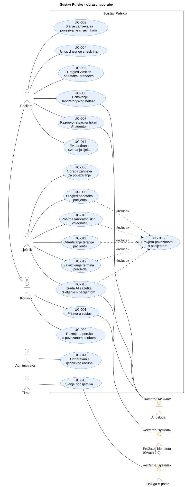

# 3. Obrasci uporabe

Ovo poglavlje prikazuje glavne interakcije aktera s aplikacijom Pulsko: tko koristi sustav, s kojim ciljem i što se događa kada važan korak ne uspije. Obrasci uporabe temelje se na opsegu iz [1. Opseg projekta](1-Projekt.md) i zahtjevima iz [2. Analiza zahtjeva](2-Analiza-zahtjeva.md).

## 3.1 Dijagram obrazaca uporabe

**Slika 3.1. Dijagram obrazaca uporabe sustava Pulsko**

**PlantUML izvor:** [izvor](./puml/3-1-Pulsko-system-UC.puml)

**Akteri:**

| Akter                            | Vrsta                       | Uloga u sustavu                                                                                                                                                   |
| -------------------------------- | --------------------------- | ----------------------------------------------------------------------------------------------------------------------------------------------------------------- |
| Korisnik                         | Primarni (apstraktni)       | Nadakter Pacijenta i Liječnika; prijava i razmjena poruka.                                                                                                        |
| Pacijent                         | Primarni                    | Bilježi i pregledava svoje podatke, učitava nalaze, koristi pacijentskog AI agenta, povezuje se s liječnikom.                                                     |
| Liječnik                         | Primarni                    | Obrađuje zahtjeve za povezivanje, pregledava podatke pacijenata, potvrđuje laboratorijske vrijednosti, određuje terapiju i termine, dijeli provjereni AI sažetak. |
| Administrator                    | Primarni                    | Odobrava liječničke račune.                                                                                                                                       |
| Timer                            | Primarni (vremenski okidač) | Pokreće slanje podsjetnika.                                                                                                                                       |
| Pružatelj identiteta (OAuth 2.0) | Sekundarni                  | Provodi autentikaciju pri prijavi.                                                                                                                                |
| AI usluga                        | Sekundarni                  | Izdvaja vrijednosti iz nalaza, odgovara pacijentu, izrađuje sažetak za liječnika.                                                                                 |
| Usluga e-pošte                   | Sekundarni                  | Dostavlja podsjetnike e-poštom.                                                                                                                                   |

**Odnosi:** Pacijent i Liječnik specijalizacije su Korisnika. UC-009 do UC-013 uključuju (`<<include>>`) UC-016 jer liječnik smije raditi samo s povezanim pacijentom. Prijava (UC-001) nije `<<include>>` drugih obrazaca, nego njihov preduvjet. `<<extend>>` se ne koristi; iznimke su opisane kao alternativni tokovi u 3.2. Razvojni tim i baza podataka nisu akteri.

## 3.2 Specifikacije obrazaca uporabe

### UC-001: Prijava u sustav

| Element specifikacije             | Opis                                                                                                                                                                                                                                                                                                                                                                                                                                      |
| :-------------------------------- | :---------------------------------------------------------------------------------------------------------------------------------------------------------------------------------------------------------------------------------------------------------------------------------------------------------------------------------------------------------------------------------------------------------------------------------------- |
| **Primarni akter**                | Korisnik (Pacijent ili Liječnik)                                                                                                                                                                                                                                                                                                                                                                                                          |
| **Sekundarni akter**              | Pružatelj identiteta (OAuth 2.0)                                                                                                                                                                                                                                                                                                                                                                                                          |
| **Povezani zahtjevi**             | F-???                                                                                                                                                                                                                                                                                                                                                                                                                                     |
| **Preduvjeti**                    | Korisnik ima račun kod pružatelja identiteta.                                                                                                                                                                                                                                                                                                                                                                                             |
| **Glavni uspješni tok**           | 1. Korisnik odabire prijavu. 2. Aplikacija preusmjerava korisnika na pružatelja identiteta. 3. Korisnik se autentificira i odobrava pristup. 4. Aplikacija prima potvrdu identiteta. 5. Aplikacija otvara nadzornu ploču prema ulozi korisnika.                                                                                                                                                                               |
| **Alternativni tokovi / Iznimke** | **3a — Odustajanje ili neuspjela autentikacija:** korisnik ostaje neprijavljen, aplikacija nudi ponovni pokušaj. **4a — Prva prijava:** aplikacija traži odabir uloge. Pacijent odmah dobiva pristup. Liječnik unosi ustanovu i broj licence te dobiva račun _na čekanju_ dok ga Administrator ne odobri (UC-014). **5a — Liječnički račun na čekanju:** aplikacija prikazuje da odobrenje još traje i ne nudi liječničke funkcije. |
| **Posljedice (ishod)**            | Korisnik je prijavljen i vidi funkcije svoje uloge. Pri prvoj prijavi stvoren je profil.                                                                                                                                                                                                                                                                                                                                                  |

### UC-002: Razmjena poruka s povezanom osobom

| Element specifikacije             | Opis                                                                                                                                                                                                                                                       |
| :-------------------------------- | :--------------------------------------------------------------------------------------------------------------------------------------------------------------------------------------------------------------------------------------------------------- |
| **Primarni akter**                | Korisnik (Pacijent ili Liječnik)                                                                                                                                                                                                                           |
| **Povezani zahtjevi**             | F-???                                                                                                                                                                                                                                                      |
| **Preduvjeti**                    | Korisnik je prijavljen. Pacijent i liječnik su povezani (zahtjev prihvaćen, UC-008).                                                                                                                                                                       |
| **Glavni uspješni tok**           | 1. Korisnik otvara razgovor s povezanom osobom. 2. Aplikacija prikazuje dosadašnje poruke. 3. Korisnik piše i šalje poruku. 4. Aplikacija sprema poruku i prikazuje je u razgovoru. 5. Primatelj vidi novu poruku i oznaku nepročitane poruke. |
| **Alternativni tokovi / Iznimke** | **1a — Nema povezane osobe:** aplikacija ne nudi razgovor i upućuje na povezivanje (UC-003). **3a — Prazna poruka:** aplikacija ne dopušta slanje. **4a — Slanje nije uspjelo:** aplikacija prikazuje grešku, zadržava tekst i nudi ponovno slanje.  |
| **Posljedice (ishod)**            | Poruka je spremljena i vidljiva objema stranama.                                                                                                                                                                                                           |

### UC-003: Slanje zahtjeva za povezivanje s liječnikom

| Element specifikacije             | Opis                                                                                                                                                                                                                  |
| :-------------------------------- | :-------------------------------------------------------------------------------------------------------------------------------------------------------------------------------------------------------------------- |
| **Primarni akter**                | Pacijent                                                                                                                                                                                                              |
| **Povezani zahtjevi**             | F-???                                                                                                                                                                                                                 |
| **Preduvjeti**                    | Pacijent je prijavljen.                                                                                                                                                                                               |
| **Glavni uspješni tok**           | 1. Pacijent otvara pretragu liječnika. 2. Aplikacija prikazuje odobrene liječnike. 3. Pacijent odabire liječnika i šalje zahtjev. 4. Aplikacija sprema zahtjev sa statusom _na čekanju_ i prikazuje potvrdu. |
| **Alternativni tokovi / Iznimke** | **2a — Nema rezultata:** aplikacija javlja da liječnik nije pronađen. **3a — Već povezan ili zahtjev već poslan:** aplikacija ne šalje novi zahtjev i prikazuje postojeći status.                                  |
| **Posljedice (ishod)**            | Zahtjev čeka liječnikov odgovor (UC-008).                                                                                                                                                                             |

### UC-004: Unos dnevnog check-ina

| Element specifikacije             | Opis                                                                                                                                                                                                                                                                                                                                   |
| :-------------------------------- | :------------------------------------------------------------------------------------------------------------------------------------------------------------------------------------------------------------------------------------------------------------------------------------------------------------------------------------- |
| **Primarni akter**                | Pacijent                                                                                                                                                                                                                                                                                                                               |
| **Povezani zahtjevi**             | F-???                                                                                                                                                                                                                                                                                                                                  |
| **Preduvjeti**                    | Pacijent je prijavljen.                                                                                                                                                                                                                                                                                                                |
| **Glavni uspješni tok**           | 1. Pacijent otvara dnevni check-in. 2. Aplikacija prikazuje obrazac: opće stanje, san (sati), koraci, puls i tjelesna aktivnost. 3. Pacijent unosi podatke i sprema ih. 4. Aplikacija provjerava vrijednosti, sprema zapis za taj dan i ažurira trendove.                                                                     |
| **Alternativni tokovi / Iznimke** | **3a — Djelomičan unos:** pacijent može spremiti samo neka polja. **4a — Nevaljana vrijednost** (npr. puls izvan raspona ili negativni koraci): aplikacija označava polje, zadržava unos i ništa ne sprema dok se ne ispravi. **4b — Check-in za taj dan već postoji:** aplikacija nudi izmjenu postojećeg zapisa umjesto novog. |
| **Posljedice (ishod)**            | Dnevni zapis je spremljen i vidljiv pacijentu i povezanim liječnicima.                                                                                                                                                                                                                                                                 |

### UC-005: Pregled vlastitih podataka i trendova

| Element specifikacije             | Opis                                                                                                                                                                                                                                                                                                                                |
| :-------------------------------- | :---------------------------------------------------------------------------------------------------------------------------------------------------------------------------------------------------------------------------------------------------------------------------------------------------------------------------------- |
| **Primarni akter**                | Pacijent                                                                                                                                                                                                                                                                                                                            |
| **Povezani zahtjevi**             | F-???                                                                                                                                                                                                                                                                                                                               |
| **Preduvjeti**                    | Pacijent je prijavljen.                                                                                                                                                                                                                                                                                                             |
| **Glavni uspješni tok**           | 1. Pacijent otvara nadzornu ploču. 2. Aplikacija prikazuje sažetak: zadnji check-in, nadolazeće termine, aktivnu terapiju, zadnje nalaze i objašnjenja koja je podijelio liječnik. 3. Pacijent odabire vrstu podataka (npr. puls, san, biomarker) i razdoblje. 4. Aplikacija prikazuje povijest i jednostavan graf trenda. |
| **Alternativni tokovi / Iznimke** | **2a — Nema podataka:** aplikacija prikazuje praznu ploču i upućuje na check-in (UC-004) ili učitavanje nalaza (UC-006). **4a — Nepotvrđene laboratorijske vrijednosti:** prikazuju se jasno označene kao _nepotvrđene_ dok ih liječnik ne potvrdi (UC-010).                                                                     |
| **Posljedice (ishod)**            | Pacijent vidi svoje podatke. Ništa se ne mijenja.                                                                                                                                                                                                                                                                                   |

### UC-006: Učitavanje laboratorijskog nalaza

| Element specifikacije             | Opis                                                                                                                                                                                                                                                                                                                                                                                                               |
| :-------------------------------- | :----------------------------------------------------------------------------------------------------------------------------------------------------------------------------------------------------------------------------------------------------------------------------------------------------------------------------------------------------------------------------------------------------------------- |
| **Primarni akter**                | Pacijent                                                                                                                                                                                                                                                                                                                                                                                                           |
| **Sekundarni akter**              | AI usluga                                                                                                                                                                                                                                                                                                                                                                                                          |
| **Povezani zahtjevi**             | F-???                                                                                                                                                                                                                                                                                                                                                                                                              |
| **Preduvjeti**                    | Pacijent je prijavljen.                                                                                                                                                                                                                                                                                                                                                                                            |
| **Glavni uspješni tok**           | 1. Pacijent odabire učitavanje nalaza i prilaže datoteku (PDF ili slika). 2. Aplikacija sprema datoteku i šalje je AI usluzi na izdvajanje vrijednosti. 3. AI usluga vraća prepoznate biomarkere s vrijednostima i jedinicama. 4. Aplikacija prikazuje izdvojene vrijednosti pacijentu. 5. Aplikacija sprema vrijednosti sa statusom _nepotvrđeno_ i šalje ih povezanom liječniku na potvrdu (UC-010). |
| **Alternativni tokovi / Iznimke** | **1a — Nepodržan format ili prevelika datoteka:** aplikacija odbija datoteku i navodi podržane formate. **3a — AI usluga nije dostupna ili ne prepozna vrijednosti:** nalaz ostaje spremljen kao datoteka. Pacijent može ručno unijeti vrijednosti, koje su također _nepotvrđene_. **5a — Nema povezanog liječnika:** vrijednosti ostaju nepotvrđene dok se pacijent ne poveže (UC-003).                     |
| **Posljedice (ishod)**            | Nalaz i izdvojene vrijednosti su spremljeni kao nepotvrđeni i čekaju liječničku potvrdu.                                                                                                                                                                                                                                                                                                                           |

### UC-007: Razgovor s pacijentskim AI agentom

| Element specifikacije             | Opis                                                                                                                                                                                                                                                                                                                                                    |
| :-------------------------------- | :------------------------------------------------------------------------------------------------------------------------------------------------------------------------------------------------------------------------------------------------------------------------------------------------------------------------------------------------------ |
| **Primarni akter**                | Pacijent                                                                                                                                                                                                                                                                                                                                                |
| **Sekundarni akter**              | AI usluga                                                                                                                                                                                                                                                                                                                                               |
| **Povezani zahtjevi**             | F-???                                                                                                                                                                                                                                                                                                                                                   |
| **Preduvjeti**                    | Pacijent je prijavljen.                                                                                                                                                                                                                                                                                                                                 |
| **Glavni uspješni tok**           | 1. Pacijent otvara AI agenta i postavlja pitanje (npr. „Što znači moj hemoglobin?”). 2. Aplikacija šalje pitanje AI usluzi zajedno s **potvrđenim** podacima pacijenta. 3. AI usluga vraća objašnjenje. 4. Aplikacija prikazuje odgovor uz napomenu da nije liječnički savjet. 5. Pacijent po želji sprema predložena pitanja za liječnika. |
| **Alternativni tokovi / Iznimke** | **1a — Traži dijagnozu, terapiju ili promjenu doze:** agent to odbija i upućuje pacijenta na liječnika (UC-002). **2a — Nema potvrđenih podataka:** agent odgovara općenito i navodi da nema provjerenih podataka. **3a — AI usluga nije dostupna:** aplikacija javlja da agent trenutno ne radi. Ostale funkcije rade normalno.                  |
| **Posljedice (ishod)**            | Pacijent je dobio objašnjenje, a pitanja za liječnika su spremljena ako ih je odabrao. Zdravstveni podaci se ne mijenjaju.                                                                                                                                                                                                                              |

### UC-008: Obrada zahtjeva za povezivanje

| Element specifikacije             | Opis                                                                                                                                                                                                                        |
| :-------------------------------- | :-------------------------------------------------------------------------------------------------------------------------------------------------------------------------------------------------------------------------- |
| **Primarni akter**                | Liječnik                                                                                                                                                                                                                    |
| **Povezani zahtjevi**             | F-???                                                                                                                                                                                                                       |
| **Preduvjeti**                    | Liječnik je prijavljen i odobren (UC-014). Postoji barem jedan zahtjev _na čekanju_.                                                                                                                                        |
| **Glavni uspješni tok**           | 1. Liječnik otvara popis zahtjeva na čekanju. 2. Aplikacija prikazuje zahtjeve s osnovnim podacima pacijenata. 3. Liječnik prihvaća zahtjev. 4. Aplikacija povezuje pacijenta i liječnika i obavještava pacijenta. |
| **Alternativni tokovi / Iznimke** | **3a — Liječnik odbija zahtjev:** aplikacija postavlja status _odbijen_ i obavještava pacijenta. Veza se ne stvara. **3b — Pacijent je u međuvremenu povukao zahtjev:** aplikacija javlja da zahtjev više ne postoji.    |
| **Posljedice (ishod)**            | Pacijent i liječnik su povezani (ili je zahtjev odbijen). Liječnik od sada vidi podatke pacijenta.                                                                                                                          |

### UC-009: Pregled podataka pacijenta

| Element specifikacije             | Opis                                                                                                                                                                                                                                                                                                                                                       |
| :-------------------------------- | :--------------------------------------------------------------------------------------------------------------------------------------------------------------------------------------------------------------------------------------------------------------------------------------------------------------------------------------------------------- |
| **Primarni akter**                | Liječnik                                                                                                                                                                                                                                                                                                                                                   |
| **Povezani zahtjevi**             | F-???                                                                                                                                                                                                                                                                                                                                                      |
| **Preduvjeti**                    | Liječnik je prijavljen i odobren.                                                                                                                                                                                                                                                                                                                          |
| **Glavni uspješni tok**           | 1. Liječnik otvara popis svojih pacijenata i odabire pacijenta. 2. Aplikacija provjerava povezanost s pacijentom (**«include» UC-016**). 3. Aplikacija prikazuje pacijentove check-inove, nalaze (potvrđene i nepotvrđene), terapiju, termine i trendove. 4. Liječnik odabire vrstu podataka i razdoblje, a aplikacija prikazuje povijest i graf. |
| **Alternativni tokovi / Iznimke** | **1a — Nema povezanih pacijenata:** aplikacija prikazuje prazan popis. **2a — Pacijent nije povezan:** aplikacija odbija pristup i ne prikazuje podatke.                                                                                                                                                                                                |
| **Posljedice (ishod)**            | Liječnik vidi podatke pacijenta. Ništa se ne mijenja.                                                                                                                                                                                                                                                                                                      |

### UC-010: Potvrda laboratorijskih vrijednosti

| Element specifikacije             | Opis                                                                                                                                                                                                                                                                                                                                              |
| :-------------------------------- | :------------------------------------------------------------------------------------------------------------------------------------------------------------------------------------------------------------------------------------------------------------------------------------------------------------------------------------------------ |
| **Primarni akter**                | Liječnik                                                                                                                                                                                                                                                                                                                                          |
| **Povezani zahtjevi**             | F-???                                                                                                                                                                                                                                                                                                                                             |
| **Preduvjeti**                    | Liječnik je prijavljen i odobren. Pacijent ima nalaz s _nepotvrđenim_ vrijednostima (UC-006).                                                                                                                                                                                                                                                     |
| **Glavni uspješni tok**           | 1. Liječnik otvara nalaz koji čeka potvrdu. 2. Aplikacija provjerava povezanost s pacijentom (**«include» UC-016**). 3. Aplikacija prikazuje izvornu datoteku i izdvojene vrijednosti jednu uz drugu. 4. Liječnik provjerava vrijednosti i potvrđuje ih. 5. Aplikacija mijenja status u _potvrđeno_ i bilježi tko je i kada potvrdio. |
| **Alternativni tokovi / Iznimke** | **4a — Vrijednost je pogrešna:** liječnik je ispravlja prije potvrde. Aplikacija bilježi izvornu i ispravljenu vrijednost. **4b — Nalaz je nečitljiv ili neispravan:** liječnik ga odbija uz komentar. Vrijednosti se ne potvrđuju, a pacijent je obaviješten.                                                                                 |
| **Posljedice (ishod)**            | Vrijednosti su potvrđene (ili odbijene) i zabilježene. Od tada ih pacijentski AI agent može koristiti (UC-007).                                                                                                                                                                                                                                   |

### UC-011: Određivanje terapije pacijentu

| Element specifikacije             | Opis                                                                                                                                                                                                                                                                                                                                                    |
| :-------------------------------- | :------------------------------------------------------------------------------------------------------------------------------------------------------------------------------------------------------------------------------------------------------------------------------------------------------------------------------------------------------ |
| **Primarni akter**                | Liječnik                                                                                                                                                                                                                                                                                                                                                |
| **Povezani zahtjevi**             | F-???                                                                                                                                                                                                                                                                                                                                                   |
| **Preduvjeti**                    | Liječnik je prijavljen i odobren.                                                                                                                                                                                                                                                                                                                       |
| **Glavni uspješni tok**           | 1. Liječnik odabire pacijenta i otvara terapiju. 2. Aplikacija provjerava povezanost s pacijentom (**«include» UC-016**). 3. Liječnik unosi lijek, dozu, raspored uzimanja i trajanje. 4. Aplikacija provjerava obavezna polja, sprema terapiju i bilježi promjenu. 5. Terapija se prikazuje pacijentu, a podsjetnici se zakazuju (UC-015). |
| **Alternativni tokovi / Iznimke** | **3a — Izmjena ili ukidanje postojeće terapije:** liječnik mijenja dozu ili završava terapiju. Aplikacija bilježi staru i novu vrijednost, a podsjetnici se ažuriraju. **4a — Nedostaje obavezno polje:** aplikacija ga označava, zadržava unos i ništa ne sprema.                                                                                   |
| **Posljedice (ishod)**            | Terapija je spremljena i vidljiva pacijentu, promjena je zabilježena i podsjetnici su zakazani.                                                                                                                                                                                                                                                         |

### UC-012: Zakazivanje termina pregleda

| Element specifikacije             | Opis                                                                                                                                                                                                                                                                                                             |
| :-------------------------------- | :--------------------------------------------------------------------------------------------------------------------------------------------------------------------------------------------------------------------------------------------------------------------------------------------------------------- |
| **Primarni akter**                | Liječnik                                                                                                                                                                                                                                                                                                         |
| **Povezani zahtjevi**             | F-???                                                                                                                                                                                                                                                                                                            |
| **Preduvjeti**                    | Liječnik je prijavljen i odobren.                                                                                                                                                                                                                                                                                |
| **Glavni uspješni tok**           | 1. Liječnik odabire pacijenta i otvara termine. 2. Aplikacija provjerava povezanost s pacijentom (**«include» UC-016**). 3. Liječnik unosi datum, vrijeme, mjesto i napomenu. 4. Aplikacija provjerava podatke i sprema termin. 5. Termin se prikazuje pacijentu, a podsjetnik se zakazuje (UC-015). |
| **Alternativni tokovi / Iznimke** | **3a — Termin u prošlosti ili preklapanje s drugim terminom liječnika:** aplikacija upozorava i ne sprema termin dok se ne ispravi. **3b — Pomicanje ili otkazivanje termina:** liječnik mijenja ili otkazuje postojeći termin. Pacijent je obaviješten, a podsjetnik se ažurira.                             |
| **Posljedice (ishod)**            | Termin je spremljen i vidljiv pacijentu, a podsjetnik je zakazan.                                                                                                                                                                                                                                                |

### UC-013: Izrada AI sažetka i dijeljenje s pacijentom

| Element specifikacije             | Opis                                                                                                                                                                                                                                                                                                                                                                                                                                                                                                                       |
| :-------------------------------- | :------------------------------------------------------------------------------------------------------------------------------------------------------------------------------------------------------------------------------------------------------------------------------------------------------------------------------------------------------------------------------------------------------------------------------------------------------------------------------------------------------------------------- |
| **Primarni akter**                | Liječnik                                                                                                                                                                                                                                                                                                                                                                                                                                                                                                                   |
| **Sekundarni akter**              | AI usluga                                                                                                                                                                                                                                                                                                                                                                                                                                                                                                                  |
| **Povezani zahtjevi**             | F-???                                                                                                                                                                                                                                                                                                                                                                                                                                                                                                                      |
| **Preduvjeti**                    | Liječnik je prijavljen i odobren.                                                                                                                                                                                                                                                                                                                                                                                                                                                                                          |
| **Glavni uspješni tok**           | 1. Liječnik odabire pacijenta i traži AI sažetak. 2. Aplikacija provjerava povezanost s pacijentom (**«include» UC-016**). 3. Aplikacija šalje dostupne podatke pacijenta AI usluzi. 4. AI usluga vraća sažetak, predložena pitanja i nacrt objašnjenja za pacijenta. 5. Aplikacija prikazuje nacrt liječniku, označen kao AI sadržaj. 6. Liječnik pregledava i uređuje nacrt, zatim ga dijeli s pacijentom. 7. Aplikacija sprema podijeljeni tekst, bilježi tko ga je odobrio i prikazuje ga pacijentu. |
| **Alternativni tokovi / Iznimke** | **4a — AI usluga nije dostupna:** aplikacija javlja grešku, a liječnik može ručno napisati objašnjenje. **6a — Liječnik ne želi dijeliti:** sažetak ostaje samo liječniku i pacijent ga ne vidi.                                                                                                                                                                                                                                                                                                                        |
| **Posljedice (ishod)**            | Liječnik ima sažetak. Pacijent vidi samo sadržaj koji je liječnik pregledao i odobrio.                                                                                                                                                                                                                                                                                                                                                                                                                                     |

### UC-014: Odobravanje liječničkog računa

| Element specifikacije             | Opis                                                                                                                                                                                                                                                                                                  |
| :-------------------------------- | :---------------------------------------------------------------------------------------------------------------------------------------------------------------------------------------------------------------------------------------------------------------------------------------------------- |
| **Primarni akter**                | Administrator                                                                                                                                                                                                                                                                                         |
| **Povezani zahtjevi**             | F-???                                                                                                                                                                                                                                                                                                 |
| **Preduvjeti**                    | Administrator je prijavljen. Postoji liječnički račun _na čekanju_ (UC-001, 4a).                                                                                                                                                                                                                      |
| **Glavni uspješni tok**           | 1. Administrator otvara popis liječničkih računa na čekanju. 2. Aplikacija prikazuje podatke koje je liječnik naveo (ime, ustanova, broj licence). 3. Administrator provjerava podatke i odobrava račun. 4. Aplikacija aktivira liječničku ulogu, bilježi odobrenje i obavještava liječnika. |
| **Alternativni tokovi / Iznimke** | **3a — Podaci nisu valjani:** administrator odbija račun uz razlog. Liječnik je obaviješten i nema pristup liječničkim funkcijama.                                                                                                                                                                    |
| **Posljedice (ishod)**            | Liječnik je odobren i vidljiv pacijentima u pretrazi (UC-003), ili je odbijen.                                                                                                                                                                                                                        |

### UC-015: Slanje podsjetnika

| Element specifikacije             | Opis                                                                                                                                                                                                                                                                                                      |
| :-------------------------------- | :-------------------------------------------------------------------------------------------------------------------------------------------------------------------------------------------------------------------------------------------------------------------------------------------------------- |
| **Primarni akter**                | Timer                                                                                                                                                                                                                                                                                                     |
| **Sekundarni akter**              | Usluga e-pošte                                                                                                                                                                                                                                                                                            |
| **Povezani zahtjevi**             | F-???                                                                                                                                                                                                                                                                                                     |
| **Preduvjeti**                    | Postoji aktivna terapija (UC-011) ili nadolazeći termin (UC-012) s podsjetnikom.                                                                                                                                                                                                                          |
| **Glavni uspješni tok**           | 1. Timer pokreće provjeru u zadanom vremenu. 2. Aplikacija pronalazi podsjetnike koji su dospjeli (uzimanje lijeka, termin sutra). 3. Aplikacija prikazuje obavijest pacijentu u aplikaciji. 4. Aplikacija šalje e-poštu preko usluge e-pošte. 5. Aplikacija bilježi da je podsjetnik poslan. |
| **Alternativni tokovi / Iznimke** | **2a — Nema dospjelih podsjetnika:** ništa se ne šalje. **4a — Usluga e-pošte nije dostupna:** obavijest u aplikaciji ostaje, a slanje e-pošte se ponavlja kasnije.                                                                                                                                    |
| **Posljedice (ishod)**            | Pacijent je dobio podsjetnik, a slanje je zabilježeno. Isti podsjetnik se ne šalje dvaput.                                                                                                                                                                                                                |

### UC-016: Provjera povezanosti s pacijentom

| Element specifikacije             | Opis                                                                                                                                      |
| :-------------------------------- | :---------------------------------------------------------------------------------------------------------------------------------------- |
| **Primarni akter**                | Nema izravnog aktera. Uključuju ga UC-009 do UC-013 (Liječnik).                                                                           |
| **Povezani zahtjevi**             | F-???                                                                                                                                     |
| **Preduvjeti**                    | Liječnik je prijavljen i odabrao je pacijenta.                                                                                            |
| **Glavni uspješni tok**           | 1. Aplikacija provjerava postoji li prihvaćena veza između liječnika i odabranog pacijenta. 2. Veza postoji i osnovni UC se nastavlja. |
| **Alternativni tokovi / Iznimke** | **2a — Veza ne postoji:** aplikacija odbija radnju, ne prikazuje i ne mijenja podatke pacijenta, a pokušaj bilježi.                       |
| **Posljedice (ishod)**            | Liječnik radi samo s podacima pacijenta koji je prihvatio povezivanje.                                                                    |

---

## 3.3 Provjera dosljednosti obrazaca uporabe

| Provjera   | Stanje                                                                                                                                                                                                              |
| ---------- | ------------------------------------------------------------------------------------------------------------------------------------------------------------------------------------------------------------------- |
| Zahtjev    | Svaki obrazac uporabe bit će povezan s funkcijskim zahtjevom iz 2.1; poveznice se održavaju u [matrici sljedivosti](2-Analiza-zahtjeva.md#26-sljedivost-zahtjeva). _Na čekanju: popis zahtjeva u izradi._           |
| Akter      | Akteri odgovaraju ulogama iz 1.2 i 2.3; Administrator je dodan radi odobravanja liječničkih računa.                                                                                                                 |
| Aplikacija | Opisi su trenutačno oblikovanje (iteracija 1); otvorena pitanja (format nalaza, poruke u stvarnom vremenu, prijedlog termina od strane pacijenta, provjera liječnika) bit će usklađena nakon dogovora s asistentom. |
