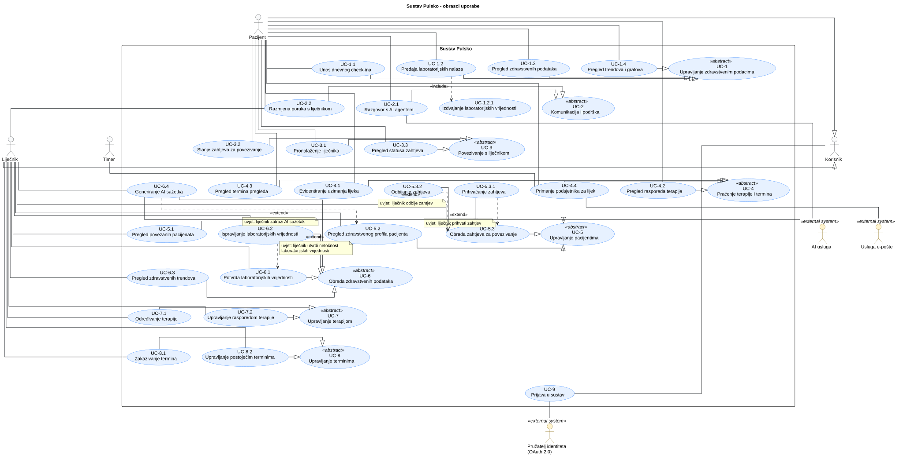

# 3. Obrasci uporabe

Ovo poglavlje prikazuje glavne interakcije aktera sa sustavom Pulsko. Prikazani su akteri, njihove uloge, obrasci uporabe te odnosi između općenitijih i konkretnijih obrazaca uporabe. Struktura je usklađena s dostavljenim PlantUML dijagramom.

## 3.1 Dijagram obrazaca uporabe

**Slika 3.1. Dijagram obrazaca uporabe sustava Pulsko**

**PlantUML izvor:** [izvor](./puml/3-1-Pulsko-system-UC.puml)

### Akteri

| Akter                            | Vrsta                       | Uloga u sustavu                                                                                                                                                                                                       |
| -------------------------------- | --------------------------- | --------------------------------------------------------------------------------------------------------------------------------------------------------------------------------------------------------------------- |
| Korisnik                         | Primarni (općeniti)         | Općeniti akter čije uloge nasljeđuju Pacijent i Liječnik. Sudjeluje u prijavi u sustav.                                                                                                                               |
| Pacijent                         | Primarni                    | Unosi i pregledava vlastite zdravstvene podatke, predaje laboratorijske nalaze, komunicira s AI agentom i liječnikom, povezuje se s liječnikom te prati terapiju i termine.                                           |
| Liječnik                         | Primarni                    | Pregledava povezane pacijente i njihove podatke, obrađuje zahtjeve za povezivanje, potvrđuje i ispravlja laboratorijske vrijednosti, izrađuje AI sažetke, upravlja terapijom i terminima te komunicira s pacijentima. |
| Timer                            | Primarni (vremenski okidač) | Pokreće postupak slanja podsjetnika.                                                                                                                                                                                  |
| Pružatelj identiteta (OAuth 2.0) | Sekundarni                  | Provodi autentikaciju korisnika pri prijavi u sustav.                                                                                                                                                                 |
| AI usluga                        | Sekundarni                  | Sudjeluje u razgovoru s pacijentom i generiranju sažetka za liječnika.                                                                                                                                                |
| Usluga e-pošte                   | Sekundarni                  | Dostavlja podsjetnike putem e-pošte.                                                                                                                                                                                  |

### Glavni obrasci uporabe

Glavni obrasci uporabe predstavljaju šira funkcionalna područja sustava. U dijagramu su označeni kao apstraktni, a konkretni obrasci uporabe prikazani su kao njihove specijalizacije.

| Oznaka | Naziv                             | Uloga u sustavu                                                                                              |
| ------ | --------------------------------- | ------------------------------------------------------------------------------------------------------------ |
| UC-1   | Upravljanje zdravstvenim podacima | Obuhvaća unos, predaju i pregled zdravstvenih podataka te pregled trendova.                                  |
| UC-2   | Komunikacija i podrška            | Obuhvaća razgovor pacijenta s AI agentom i razmjenu poruka s liječnikom.                                     |
| UC-3   | Povezivanje s liječnikom          | Obuhvaća pronalaženje liječnika, slanje zahtjeva i pregled njegova statusa.                                  |
| UC-4   | Praćenje terapije i termina       | Obuhvaća evidentiranje uzimanja lijeka, pregled terapije i termina te primanje podsjetnika.                  |
| UC-5   | Upravljanje pacijentima           | Obuhvaća pregled povezanih pacijenata, njihovih profila i obradu zahtjeva za povezivanje.                    |
| UC-6   | Obrada zdravstvenih podataka      | Obuhvaća potvrđivanje i ispravljanje laboratorijskih vrijednosti, pregled trendova i generiranje AI sažetka. |
| UC-7   | Upravljanje terapijom             | Obuhvaća određivanje terapije i upravljanje rasporedom terapije.                                             |
| UC-8   | Upravljanje terminima             | Obuhvaća zakazivanje i upravljanje postojećim terminima.                                                     |
| UC-9   | Prijava u sustav                  | Omogućuje korisniku prijavu u sustav putem vanjskog pružatelja identiteta.                                   |

### Odnosi

- Pacijent i Liječnik specijalizacije su općenitog aktera Korisnik.
- Konkretni obrasci uporabe povezani su s odgovarajućim glavnim obrascima uporabom UML generalizacije.
- UC-1.2 uključuje UC-1.2.1 jer se pri predaji laboratorijskog nalaza izdvajaju laboratorijske vrijednosti.
- UC-5.3 može se proširiti prihvaćanjem ili odbijanjem zahtjeva, ovisno o odluci liječnika.
- UC-6.1 može se proširiti ispravljanjem laboratorijskih vrijednosti kada liječnik utvrdi netočnost.
- UC-6.4 proširuje pregled zdravstvenog profila kada liječnik zatraži AI sažetak.
- Pružatelj identiteta sudjeluje u UC-9, AI usluga u UC-2.1 i UC-6.4, a Usluga e-pošte i Timer u UC-4.4.
- Skrivene veze u PlantUML kodu služe isključivo za vizualno poravnanje elemenata i ne predstavljaju UML odnose.

## 3.2 Specifikacije obrazaca uporabe

### UC-1: Upravljanje zdravstvenim podacima

**Svrha:** Omogućiti pacijentu unos, predaju i pregled zdravstvenih podataka te praćenje njihovih promjena kroz vrijeme.

| Element specifikacije     | Opis                                                                                                                                           |
| ------------------------- | ---------------------------------------------------------------------------------------------------------------------------------------------- |
| Primarni akter            | Pacijent                                                                                                                                       |
| Povezani zahtjevi         | F-004, F-005, F-006, F-007, F-009, F-010                                                                                                       |
| Konkretni obrasci uporabe | UC-1.1 Unos dnevnog check-ina; UC-1.2 Predaja laboratorijskih nalaza; UC-1.3 Pregled zdravstvenih podataka; UC-1.4 Pregled trendova i grafova  |
| Povezani vanjski sustavi  | AI usluga sudjeluje u izdvajanju vrijednosti iz laboratorijskog nalaza kroz UC-1.2.1.                                                          |
| Ishod                     | Zdravstveni podaci pacijenta pohranjeni su i dostupni za pregled, uz jasno razlikovanje potvrđenih i nepotvrđenih laboratorijskih vrijednosti. |

#### UC-1.1: Unos dnevnog check-ina

| Element specifikacije         | Opis                                                                                                                                                                                                        |
| ----------------------------- | ----------------------------------------------------------------------------------------------------------------------------------------------------------------------------------------------------------- |
| Primarni akter                | Pacijent                                                                                                                                                                                                    |
| Povezani zahtjevi             | F-005, F-006, F-009                                                                                                                                                                                         |
| Preduvjeti                    | Pacijent je prijavljen.                                                                                                                                                                                     |
| Glavni uspješni tok           | Pacijent otvara dnevni check-in, unosi dostupne podatke o općem stanju, snu, koracima, pulsu i tjelesnoj aktivnosti te sprema zapis. Sustav provjerava vrijednosti, sprema dnevni zapis i ažurira trendove. |
| Alternativni tokovi / Iznimke | Pacijent može spremiti djelomičan unos. Ako je vrijednost nevaljana, sustav označava polje i traži ispravak. Ako zapis za taj dan već postoji, sustav nudi izmjenu postojećeg zapisa.                       |
| Ishod                         | Dnevni zapis spremljen je i vidljiv pacijentu i povezanim liječnicima.                                                                                                                                      |

#### UC-1.2: Predaja laboratorijskih nalaza

| Element specifikacije         | Opis                                                                                                                                                                                                                                                         |
| ----------------------------- | ------------------------------------------------------------------------------------------------------------------------------------------------------------------------------------------------------------------------------------------------------------ |
| Primarni akter                | Pacijent                                                                                                                                                                                                                                                     |
| Sekundarni akter              | AI usluga                                                                                                                                                                                                                                                    |
| Povezani zahtjevi             | F-006, F-007                                                                                                                                                                                                                                                 |
| Preduvjeti                    | Pacijent je prijavljen.                                                                                                                                                                                                                                      |
| Glavni uspješni tok           | Pacijent prilaže PDF nalaz ili nalaze. Sustav sprema dokumente i šalje ih AI usluzi radi izdvajanja vrijednosti. Izdvojene vrijednosti prikazuju se pacijentu, spremaju sa statusom nepotvrđeno i šalju povezanom liječniku na provjeru.                     |
| Alternativni tokovi / Iznimke | Nepodržana datoteka se odbija. Ako AI usluga nije dostupna ili ne prepozna vrijednosti, dokument ostaje spremljen, a pacijent može ručno unijeti vrijednosti koje ostaju nepotvrđene. Ako pacijent nema povezanog liječnika, vrijednosti ostaju nepotvrđene. |
| Ishod                         | Nalaz i izdvojene vrijednosti spremljeni su kao nepotvrđeni i čekaju liječničku potvrdu.                                                                                                                                                                     |

#### UC-1.2.1: Izdvajanje laboratorijskih vrijednosti

| Element specifikacije         | Opis                                                                                                                            |
| ----------------------------- | ------------------------------------------------------------------------------------------------------------------------------- |
| Primarni akter                | Nema izravnog primarnog aktera; postupak se izvodi u sklopu predaje laboratorijskog nalaza.                                     |
| Sekundarni akter              | AI usluga                                                                                                                       |
| Povezani zahtjevi             | F-007                                                                                                                           |
| Preduvjeti                    | Pacijent je predao podržani laboratorijski dokument.                                                                            |
| Glavni uspješni tok           | Sustav šalje dokument AI usluzi. AI usluga prepoznaje laboratorijske vrijednosti i pripadajuće jedinice te ih vraća sustavu.    |
| Alternativni tokovi / Iznimke | Ako AI usluga nije dostupna ili ne može prepoznati vrijednosti, dokument ostaje spremljen, a vrijednosti se mogu unijeti ručno. |
| Ishod                         | Izdvojene vrijednosti dostupne su za pregled i liječničku potvrdu.                                                              |

#### UC-1.3: Pregled zdravstvenih podataka

| Element specifikacije         | Opis                                                                                                                                                                            |
| ----------------------------- | ------------------------------------------------------------------------------------------------------------------------------------------------------------------------------- |
| Primarni akter                | Pacijent                                                                                                                                                                        |
| Povezani zahtjevi             | F-004, F-010                                                                                                                                                                    |
| Preduvjeti                    | Pacijent je prijavljen.                                                                                                                                                         |
| Glavni uspješni tok           | Pacijent otvara nadzornu ploču i pregledava sažetak zdravstvenih podataka, uključujući zadnji check-in, nalaze, terapiju i objašnjenja koja je podijelio liječnik.              |
| Alternativni tokovi / Iznimke | Ako podaci još nisu uneseni, sustav prikazuje prazno stanje i upućuje pacijenta na unos check-ina ili predaju nalaza. Nepotvrđene laboratorijske vrijednosti jasno su označene. |
| Ishod                         | Pacijent pregledava vlastite zdravstvene podatke; podaci se ne mijenjaju.                                                                                                       |

#### UC-1.4: Pregled trendova i grafova

| Element specifikacije         | Opis                                                                                                                                                    |
| ----------------------------- | ------------------------------------------------------------------------------------------------------------------------------------------------------- |
| Primarni akter                | Pacijent                                                                                                                                                |
| Povezani zahtjevi             | F-010                                                                                                                                                   |
| Preduvjeti                    | Pacijent je prijavljen i postoje podaci za odabranu vrstu mjerenja.                                                                                     |
| Glavni uspješni tok           | Pacijent odabire vrstu podatka, primjerice puls, san ili biomarker, i vremensko razdoblje. Sustav prikazuje povijest vrijednosti i graf trenda.         |
| Alternativni tokovi / Iznimke | Ako za odabrano razdoblje nema podataka, sustav prikazuje odgovarajuću obavijest. Nepotvrđene laboratorijske vrijednosti označavaju se kao nepotvrđene. |
| Ishod                         | Pacijent vidi povijest i trend odabranih zdravstvenih podataka.                                                                                         |

### UC-2: Komunikacija i podrška

**Svrha:** Omogućiti pacijentu komunikaciju s AI agentom i razmjenu poruka s povezanim liječnikom.

| Element specifikacije     | Opis                                                                                                     |
| ------------------------- | -------------------------------------------------------------------------------------------------------- |
| Primarni akteri           | Pacijent i Liječnik                                                                                      |
| Povezani zahtjevi         | F-011, F-015, F-020                                                                                      |
| Konkretni obrasci uporabe | UC-2.1 Razgovor s AI agentom; UC-2.2 Razmjena poruka s liječnikom                                        |
| Sekundarni akter          | AI usluga za UC-2.1                                                                                      |
| Ishod                     | Pacijent dobiva objašnjenja u okviru mogućnosti AI agenta ili razmjenjuje poruke s povezanim liječnikom. |

#### UC-2.1: Razgovor s AI agentom

| Element specifikacije         | Opis                                                                                                                                                                                                                                                                      |
| ----------------------------- | ------------------------------------------------------------------------------------------------------------------------------------------------------------------------------------------------------------------------------------------------------------------------- |
| Primarni akter                | Pacijent                                                                                                                                                                                                                                                                  |
| Sekundarni akter              | AI usluga                                                                                                                                                                                                                                                                 |
| Povezani zahtjevi             | F-015                                                                                                                                                                                                                                                                     |
| Preduvjeti                    | Pacijent je prijavljen.                                                                                                                                                                                                                                                   |
| Glavni uspješni tok           | Pacijent postavlja pitanje AI agentu. Sustav šalje pitanje zajedno s potvrđenim podacima pacijenta AI usluzi. AI usluga vraća objašnjenje, a sustav ga prikazuje uz napomenu da nije riječ o liječničkom savjetu. Pacijent može spremiti predložena pitanja za liječnika. |
| Alternativni tokovi / Iznimke | Zahtjeve za dijagnozu, određivanje terapije ili promjenu doze AI agent odbija i upućuje pacijenta liječniku. Ako nema potvrđenih podataka, agent odgovara općenito i navodi to ograničenje. Ako AI usluga nije dostupna, sustav prikazuje obavijest.                      |
| Ishod                         | Pacijent je dobio objašnjenje; pitanja za liječnika spremljena su ako ih je pacijent odabrao. Zdravstveni podaci se ne mijenjaju.                                                                                                                                         |

#### UC-2.2: Razmjena poruka s liječnikom

| Element specifikacije         | Opis                                                                                                                                                                            |
| ----------------------------- | ------------------------------------------------------------------------------------------------------------------------------------------------------------------------------- |
| Primarni akteri               | Pacijent i Liječnik                                                                                                                                                             |
| Povezani zahtjevi             | F-011, F-020                                                                                                                                                                    |
| Preduvjeti                    | Korisnik je prijavljen, a pacijent i liječnik su povezani.                                                                                                                      |
| Glavni uspješni tok           | Korisnik otvara razgovor s povezanom osobom, pregledava dosadašnje poruke, sastavlja i šalje poruku. Sustav sprema poruku i prikazuje je u razgovoru primatelja.                |
| Alternativni tokovi / Iznimke | Ako nema povezane osobe, sustav upućuje korisnika na postupak povezivanja. Prazna poruka ne može se poslati. Ako slanje ne uspije, tekst se zadržava i nudi se ponovni pokušaj. |
| Ishod                         | Poruka je spremljena i vidljiva objema stranama.                                                                                                                                |

### UC-3: Povezivanje s liječnikom

**Svrha:** Omogućiti pacijentu pronalaženje liječnika i slanje zahtjeva za povezivanje te pregled statusa zahtjeva.

| Element specifikacije         | Opis                                                                                                                                                                      |
| ----------------------------- | ------------------------------------------------------------------------------------------------------------------------------------------------------------------------- |
| Primarni akter                | Pacijent                                                                                                                                                                  |
| Povezani zahtjevi             | F-003                                                                                                                                                                     |
| Konkretni obrasci uporabe     | UC-3.1 Pronalaženje liječnika; UC-3.2 Slanje zahtjeva za povezivanje; UC-3.3 Pregled statusa zahtjeva                                                                     |
| Preduvjeti                    | Pacijent je prijavljen.                                                                                                                                                   |
| Glavni uspješni tok           | Pacijent pretražuje popis odobrenih liječnika, odabire liječnika i šalje zahtjev. Sustav sprema zahtjev sa statusom na čekanju.                                           |
| Alternativni tokovi / Iznimke | Ako nema rezultata, sustav obavještava pacijenta. Ako je pacijent već povezan ili je zahtjev već poslan, sustav prikazuje postojeći status umjesto slanja novog zahtjeva. |
| Ishod                         | Zahtjev čeka odgovor liječnika. Nakon prihvaćanja uspostavlja se veza između pacijenta i liječnika.                                                                       |

### UC-4: Praćenje terapije i termina

**Svrha:** Omogućiti pacijentu praćenje rasporeda terapije i termina, evidentiranje uzimanja lijekova i primanje podsjetnika.

| Element specifikacije     | Opis                                                                                                                                           |
| ------------------------- | ---------------------------------------------------------------------------------------------------------------------------------------------- |
| Primarni akter            | Pacijent                                                                                                                                       |
| Povezani zahtjevi         | F-012, F-013, F-014, F-018                                                                                                                     |
| Konkretni obrasci uporabe | UC-4.1 Evidentiranje uzimanja lijeka; UC-4.2 Pregled rasporeda terapije; UC-4.3 Pregled termina pregleda; UC-4.4 Primanje podsjetnika za lijek |
| Sekundarni akteri         | Timer i Usluga e-pošte za slanje podsjetnika                                                                                                   |
| Ishod                     | Pacijent ima pregled terapije i termina te može evidentirati status doze.                                                                      |

#### UC-4.1: Evidentiranje uzimanja lijeka

| Element specifikacije         | Opis                                                                                                                                                                                 |
| ----------------------------- | ------------------------------------------------------------------------------------------------------------------------------------------------------------------------------------ |
| Primarni akter                | Pacijent                                                                                                                                                                             |
| Povezani zahtjevi             | F-018                                                                                                                                                                                |
| Preduvjeti                    | Pacijent je prijavljen i ima aktivnu terapiju.                                                                                                                                       |
| Glavni uspješni tok           | Pacijent otvara današnje doze. Sustav prikazuje lijek, količinu i vrijeme uzimanja. Pacijent označava dozu kao uzetu ili propuštenu, a sustav sprema status i vrijeme evidentiranja. |
| Alternativni tokovi / Iznimke | Ako je status pogrešno označen, pacijent ga može promijeniti, a sustav bilježi promjenu.                                                                                             |
| Ishod                         | Status doze spremljen je i vidljiv pacijentu i povezanom liječniku.                                                                                                                  |

#### UC-4.2: Pregled rasporeda terapije

| Element specifikacije         | Opis                                                                                                        |
| ----------------------------- | ----------------------------------------------------------------------------------------------------------- |
| Primarni akter                | Pacijent                                                                                                    |
| Povezani zahtjevi             | F-013                                                                                                       |
| Preduvjeti                    | Pacijent je prijavljen.                                                                                     |
| Glavni uspješni tok           | Pacijent otvara pregled terapije. Sustav prikazuje aktivne lijekove, količine, raspored i vremena uzimanja. |
| Alternativni tokovi / Iznimke | Ako pacijent nema aktivnu terapiju, sustav prikazuje da terapija nije definirana.                           |
| Ishod                         | Pacijent vidi svoj raspored terapije.                                                                       |

#### UC-4.3: Pregled termina pregleda

| Element specifikacije         | Opis                                                                                                    |
| ----------------------------- | ------------------------------------------------------------------------------------------------------- |
| Primarni akter                | Pacijent                                                                                                |
| Povezani zahtjevi             | F-012                                                                                                   |
| Preduvjeti                    | Pacijent je prijavljen.                                                                                 |
| Glavni uspješni tok           | Pacijent otvara pregled termina. Sustav prikazuje nadolazeće i prethodne termine s dostupnim detaljima. |
| Alternativni tokovi / Iznimke | Ako nema zakazanih termina, sustav prikazuje odgovarajuću obavijest.                                    |
| Ishod                         | Pacijent vidi svoje termine pregleda.                                                                   |

#### UC-4.4: Primanje podsjetnika za lijek

| Element specifikacije         | Opis                                                                                                                                                      |
| ----------------------------- | --------------------------------------------------------------------------------------------------------------------------------------------------------- |
| Primarni akter                | Timer                                                                                                                                                     |
| Sekundarni akter              | Usluga e-pošte                                                                                                                                            |
| Povezani zahtjevi             | F-014                                                                                                                                                     |
| Preduvjeti                    | Postoji aktivna terapija s definiranim podsjetnikom.                                                                                                      |
| Glavni uspješni tok           | Timer pokreće provjeru dospjelih podsjetnika. Sustav pronalazi podsjetnike, prikazuje obavijest pacijentu u aplikaciji, šalje e-poštu i bilježi slanje.   |
| Alternativni tokovi / Iznimke | Ako nema dospjelih podsjetnika, ništa se ne šalje. Ako usluga e-pošte nije dostupna, obavijest u aplikaciji ostaje, a slanje e-pošte ponavlja se kasnije. |
| Ishod                         | Pacijent je obaviješten, a slanje podsjetnika je zabilježeno.                                                                                             |

### UC-5: Upravljanje pacijentima

**Svrha:** Omogućiti liječniku pregled povezanih pacijenata, pregled njihovih zdravstvenih profila i obradu zahtjeva za povezivanje.

| Element specifikacije     | Opis                                                                                                                      |
| ------------------------- | ------------------------------------------------------------------------------------------------------------------------- |
| Primarni akter            | Liječnik                                                                                                                  |
| Povezani zahtjevi         | F-002, F-003, F-010, F-018, F-020                                                                                         |
| Konkretni obrasci uporabe | UC-5.1 Pregled povezanih pacijenata; UC-5.2 Pregled zdravstvenog profila pacijenta; UC-5.3 Obrada zahtjeva za povezivanje |
| Ishod                     | Liječnik pregledava povezane pacijente i obrađuje zahtjeve za povezivanje.                                                |

#### UC-5.1: Pregled povezanih pacijenata

| Element specifikacije         | Opis                                                                                                   |
| ----------------------------- | ------------------------------------------------------------------------------------------------------ |
| Primarni akter                | Liječnik                                                                                               |
| Povezani zahtjevi             | F-003                                                                                                  |
| Preduvjeti                    | Liječnik je prijavljen i odobren.                                                                      |
| Glavni uspješni tok           | Liječnik otvara popis pacijenata. Sustav prikazuje pacijente s kojima liječnik ima uspostavljenu vezu. |
| Alternativni tokovi / Iznimke | Ako liječnik nema povezanih pacijenata, sustav prikazuje prazan popis.                                 |
| Ishod                         | Liječnik vidi popis povezanih pacijenata.                                                              |

#### UC-5.2: Pregled zdravstvenog profila pacijenta

| Element specifikacije         | Opis                                                                                                                                       |
| ----------------------------- | ------------------------------------------------------------------------------------------------------------------------------------------ |
| Primarni akter                | Liječnik                                                                                                                                   |
| Povezani zahtjevi             | F-002, F-010, F-018                                                                                                                        |
| Preduvjeti                    | Liječnik je prijavljen i odobren te je odabrao pacijenta s kojim je povezan.                                                               |
| Glavni uspješni tok           | Liječnik otvara profil pacijenta. Sustav prikazuje check-inove, laboratorijske nalaze, terapiju s poviješću doza, termine i trendove.      |
| Alternativni tokovi / Iznimke | Ako nema povezanih pacijenata, prikazuje se prazan popis. Ako odabrani pacijent nije povezan s liječnikom, sustav odbija pristup podacima. |
| Ishod                         | Liječnik vidi zdravstveni profil pacijenta; podaci se ne mijenjaju.                                                                        |

#### UC-5.3: Obrada zahtjeva za povezivanje

| Element specifikacije         | Opis                                                                                                                                                                           |
| ----------------------------- | ------------------------------------------------------------------------------------------------------------------------------------------------------------------------------ |
| Primarni akter                | Liječnik                                                                                                                                                                       |
| Povezani zahtjevi             | F-003, F-020                                                                                                                                                                   |
| Preduvjeti                    | Liječnik je prijavljen i odobren. Postoji barem jedan zahtjev na čekanju.                                                                                                      |
| Glavni uspješni tok           | Liječnik otvara popis zahtjeva na čekanju, pregledava osnovne podatke pacijenata i prihvaća odabrani zahtjev. Sustav povezuje pacijenta i liječnika te obavještava pacijenta.  |
| Alternativni tokovi / Iznimke | Liječnik može odbiti zahtjev. Ako je pacijent povukao zahtjev, sustav obavještava liječnika. Ako je dosegnut najveći dopušteni broj pacijenata, sustav ne dopušta prihvaćanje. |
| Ishod                         | Pacijent i liječnik povezani su ili je zahtjev odbijen.                                                                                                                        |

### UC-6: Obrada zdravstvenih podataka

**Svrha:** Omogućiti liječniku provjeru laboratorijskih vrijednosti, pregled zdravstvenih trendova i izradu AI sažetka.

| Element specifikacije     | Opis                                                                                                                                                             |
| ------------------------- | ---------------------------------------------------------------------------------------------------------------------------------------------------------------- |
| Primarni akter            | Liječnik                                                                                                                                                         |
| Povezani zahtjevi         | F-002, F-008, F-010, F-016, F-017, F-020                                                                                                                         |
| Konkretni obrasci uporabe | UC-6.1 Potvrda laboratorijskih vrijednosti; UC-6.2 Ispravljanje laboratorijskih vrijednosti; UC-6.3 Pregled zdravstvenih trendova; UC-6.4 Generiranje AI sažetka |
| Sekundarni akter          | AI usluga za UC-6.4                                                                                                                                              |
| Ishod                     | Liječnik pregledava i obrađuje zdravstvene podatke te može zatražiti AI sažetak.                                                                                 |

#### UC-6.1: Potvrda laboratorijskih vrijednosti

| Element specifikacije         | Opis                                                                                                                                                                                                                                |
| ----------------------------- | ----------------------------------------------------------------------------------------------------------------------------------------------------------------------------------------------------------------------------------- |
| Primarni akter                | Liječnik                                                                                                                                                                                                                            |
| Povezani zahtjevi             | F-008, F-017, F-020                                                                                                                                                                                                                 |
| Preduvjeti                    | Liječnik je prijavljen i odobren. Pacijent ima nalaz s nepotvrđenim vrijednostima.                                                                                                                                                  |
| Glavni uspješni tok           | Liječnik otvara nalaz koji čeka potvrdu. Sustav prikazuje izvornu datoteku i izdvojene vrijednosti. Liječnik provjerava vrijednosti i potvrđuje ih. Sustav mijenja status u potvrđeno i bilježi tko je i kada potvrdio vrijednosti. |
| Alternativni tokovi / Iznimke | Ako je vrijednost pogrešna, liječnik je ispravlja prije potvrde. Ako je nalaz nečitljiv ili neispravan, liječnik ga odbija uz komentar, a vrijednosti ostaju nepotvrđene.                                                           |
| Ishod                         | Laboratorijske vrijednosti potvrđene su ili odbijene, a odluka je zabilježena.                                                                                                                                                      |

#### UC-6.2: Ispravljanje laboratorijskih vrijednosti

| Element specifikacije         | Opis                                                                                                                                                     |
| ----------------------------- | -------------------------------------------------------------------------------------------------------------------------------------------------------- |
| Primarni akter                | Liječnik                                                                                                                                                 |
| Povezani zahtjevi             | F-008, F-017                                                                                                                                             |
| Preduvjeti                    | Liječnik pregledava nepotvrđene laboratorijske vrijednosti i utvrdi da je neka vrijednost netočna.                                                       |
| Glavni uspješni tok           | Liječnik odabire netočnu vrijednost, unosi ispravnu vrijednost i nastavlja postupak provjere i potvrde. Sustav bilježi izvornu i ispravljenu vrijednost. |
| Alternativni tokovi / Iznimke | Ako liječnik ne potvrdi nalaz, vrijednosti ostaju nepotvrđene.                                                                                           |
| Ishod                         | Ispravak je zabilježen i vrijednost može biti potvrđena.                                                                                                 |

#### UC-6.3: Pregled zdravstvenih trendova

| Element specifikacije         | Opis                                                                                                                    |
| ----------------------------- | ----------------------------------------------------------------------------------------------------------------------- |
| Primarni akter                | Liječnik                                                                                                                |
| Povezani zahtjevi             | F-002, F-010                                                                                                            |
| Preduvjeti                    | Liječnik je prijavljen i ima pristup profilu povezanog pacijenta.                                                       |
| Glavni uspješni tok           | Liječnik odabire vrstu zdravstvenog podatka i vremensko razdoblje. Sustav prikazuje povijest vrijednosti i graf trenda. |
| Alternativni tokovi / Iznimke | Ako za odabrano razdoblje nema podataka, sustav prikazuje odgovarajuću obavijest.                                       |
| Ishod                         | Liječnik vidi trend odabranih zdravstvenih podataka pacijenta.                                                          |

#### UC-6.4: Generiranje AI sažetka

| Element specifikacije         | Opis                                                                                                                                                                                                                                           |
| ----------------------------- | ---------------------------------------------------------------------------------------------------------------------------------------------------------------------------------------------------------------------------------------------- |
| Primarni akter                | Liječnik                                                                                                                                                                                                                                       |
| Sekundarni akter              | AI usluga                                                                                                                                                                                                                                      |
| Povezani zahtjevi             | F-002, F-016                                                                                                                                                                                                                                   |
| Preduvjeti                    | Liječnik je prijavljen i odobren te ima pristup profilu povezanog pacijenta.                                                                                                                                                                   |
| Glavni uspješni tok           | Liječnik zatraži AI sažetak. Sustav šalje dostupne podatke pacijenta AI usluzi. AI usluga vraća sažetak, predložena pitanja i nacrt objašnjenja. Sustav prikazuje nacrt liječniku, koji ga pregledava i uređuje prije dijeljenja s pacijentom. |
| Alternativni tokovi / Iznimke | Ako AI usluga nije dostupna, liječnik može ručno napisati objašnjenje. Ako liječnik ne želi dijeliti sažetak, on ostaje vidljiv samo liječniku.                                                                                                |
| Ishod                         | Pacijent vidi samo sadržaj koji je liječnik pregledao i odobrio.                                                                                                                                                                               |

### UC-7: Upravljanje terapijom

**Svrha:** Omogućiti liječniku određivanje terapije pacijentu i upravljanje postojećim rasporedom terapije.

| Element specifikacije         | Opis                                                                                                                                                                                       |
| ----------------------------- | ------------------------------------------------------------------------------------------------------------------------------------------------------------------------------------------ |
| Primarni akter                | Liječnik                                                                                                                                                                                   |
| Povezani zahtjevi             | F-002, F-013, F-014, F-017                                                                                                                                                                 |
| Konkretni obrasci uporabe     | UC-7.1 Određivanje terapije; UC-7.2 Upravljanje rasporedom terapije                                                                                                                        |
| Preduvjeti                    | Liječnik je prijavljen i odobren te ima pristup profilu povezanog pacijenta.                                                                                                               |
| Glavni uspješni tok           | Liječnik odabire pacijenta, otvara terapiju i unosi lijek, dozu, raspored uzimanja i trajanje. Sustav provjerava obavezna polja, sprema terapiju, bilježi promjenu i zakazuje podsjetnike. |
| Alternativni tokovi / Iznimke | Liječnik može izmijeniti dozu ili završiti postojeću terapiju. Ako nedostaje obavezno polje, sustav ga označava i ne sprema unos.                                                          |
| Ishod                         | Terapija je spremljena i vidljiva pacijentu, promjena je zabilježena, a podsjetnici su ažurirani.                                                                                          |

### UC-8: Upravljanje terminima

**Svrha:** Omogućiti liječniku zakazivanje termina pregleda i upravljanje postojećim terminima.

| Element specifikacije         | Opis                                                                                                                                                                                                                               |
| ----------------------------- | ---------------------------------------------------------------------------------------------------------------------------------------------------------------------------------------------------------------------------------- |
| Primarni akter                | Liječnik                                                                                                                                                                                                                           |
| Povezani zahtjevi             | F-002, F-012, F-014, F-020                                                                                                                                                                                                         |
| Konkretni obrasci uporabe     | UC-8.1 Zakazivanje termina; UC-8.2 Upravljanje postojećim terminima                                                                                                                                                                |
| Preduvjeti                    | Liječnik je prijavljen i odobren te ima pristup profilu povezanog pacijenta.                                                                                                                                                       |
| Glavni uspješni tok           | Liječnik odabire pacijenta i unosi datum, vrijeme, mjesto i napomenu. Sustav provjerava podatke, sprema termin, prikazuje ga pacijentu i zakazuje podsjetnik.                                                                      |
| Alternativni tokovi / Iznimke | Ako je termin u prošlosti ili se preklapa s drugim terminom liječnika, sustav upozorava i ne sprema ga dok se ne ispravi. Liječnik može pomaknuti ili otkazati postojeći termin; pacijent je obaviješten, a podsjetnik se ažurira. |
| Ishod                         | Termin je spremljen i vidljiv pacijentu, a podsjetnik je zakazan.                                                                                                                                                                  |

### UC-9: Prijava u sustav

| Element specifikacije         | Opis                                                                                                                                                                                                    |
| ----------------------------- | ------------------------------------------------------------------------------------------------------------------------------------------------------------------------------------------------------- |
| Primarni akter                | Korisnik (Pacijent ili Liječnik)                                                                                                                                                                        |
| Sekundarni akter              | Pružatelj identiteta (OAuth 2.0)                                                                                                                                                                        |
| Povezani zahtjevi             | F-001, F-002                                                                                                                                                                                            |
| Preduvjeti                    | Korisnik ima račun kod pružatelja identiteta.                                                                                                                                                           |
| Glavni uspješni tok           | Korisnik odabire prijavu. Sustav ga preusmjerava na pružatelja identiteta. Korisnik se autentificira i odobrava pristup. Sustav prima potvrdu identiteta i otvara nadzornu ploču prema ulozi korisnika. |
| Alternativni tokovi / Iznimke | Ako korisnik odustane ili autentikacija ne uspije, ostaje neprijavljen i može pokušati ponovno.                                                                                                         |
| Ishod                         | Korisnik je prijavljen i pristupa funkcijama svoje uloge.                                                                                                                                               |

## 3.3 Provjera dosljednosti obrazaca uporabe

| Provjera                           | Stanje                                                                                                                                                                                                      |
| ---------------------------------- | ----------------------------------------------------------------------------------------------------------------------------------------------------------------------------------------------------------- |
| Akteri                             | Akteri u ovom prikazu odgovaraju akterima navedenima u PlantUML kodu: Korisnik, Pacijent, Liječnik, Timer, Pružatelj identiteta, AI usluga i Usluga e-pošte.                                                |
| Glavni i konkretni obrasci uporabe | Konkretni obrasci uporabe grupirani su pod glavnim obrascima UC-1 do UC-8. UC-9 predstavlja zaseban obrazac prijave u sustav.                                                                               |
| Vanjski sustavi                    | Pružatelj identiteta povezan je s prijavom, AI usluga s razgovorom i generiranjem sažetka, a Timer i Usluga e-pošte s podsjetnicima.                                                                        |
| UML odnosi                         | Generalizacija, include i extend odnosi prikazani su prema dostavljenom PlantUML kodu. Skrivene veze koriste se samo za raspored elemenata.                                                                 |
| Napomena o opsegu                  | Administrator nije prikazan kao akter u dostavljenom PlantUML kodu pa nije uključen u ovaj dokument. Pojedinosti koje nisu definirane u kodu ili dostavljenim specifikacijama nisu dodatno pretpostavljene. |
