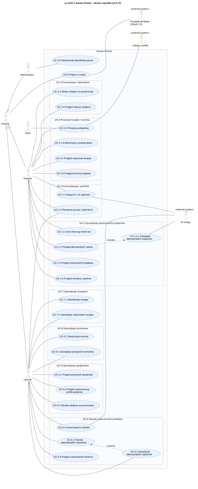

# 3. Obrasci uporabe

Ovo poglavlje prikazuje glavne interakcije aktera sa sustavom Pulsko. Prikazani su akteri, njihove uloge, obrasci uporabe te odnosi između općenitijih i konkretnijih obrazaca uporabe. Obrasci uporabe grupirani su u glavna funkcionalna područja (UC-1 do UC-8) s konkretnim obrascima (UC-x.y), kako je dogovoreno na kontrolnoj točki M0.

## 3.1 Dijagram obrazaca uporabe

**Slika 3.1. Dijagram obrazaca uporabe sustava Pulsko**

**PlantUML izvor:** [izvor](./puml/3-1-Pulsko-system-UC.puml)

### Akteri

| Akter                            | Vrsta                       | Uloga u sustavu                                                                                                                                                                                                       |
| -------------------------------- | --------------------------- | --------------------------------------------------------------------------------------------------------------------------------------------------------------------------------------------------------------------- |
| Korisnik                         | Primarni (općeniti)         | Općeniti akter čije uloge nasljeđuju Pacijent, Liječnik i Administrator. Sudjeluje u prijavi u sustav.                                                                                                                               |
| Pacijent                         | Primarni                    | Unosi i pregledava vlastite zdravstvene podatke, predaje laboratorijske nalaze, komunicira s AI agentom i liječnikom, povezuje se s liječnikom te prati terapiju i termine.                                           |
| Liječnik                         | Primarni                    | Pregledava povezane pacijente i njihove podatke, obrađuje zahtjeve za povezivanje, potvrđuje i ispravlja laboratorijske vrijednosti, izrađuje AI sažetke, upravlja terapijom i terminima te komunicira s pacijentima. |
| Administrator | Primarni | Odobrava ili odbija zahtjeve za liječničku ulogu. Ne pristupa zdravstvenim podacima pacijenata. |
| Timer                            | Primarni (vremenski okidač) | Pokreće postupak slanja podsjetnika.                                                                                                                                                                                  |
| Pružatelj identiteta (OAuth 2.0) | Sekundarni                  | Provodi autentikaciju korisnika pri prijavi u sustav.                                                                                                                                                                 |
| AI usluga                        | Sekundarni | Sudjeluje u izdvajanju laboratorijskih vrijednosti, razgovoru s pacijentom i generiranju sažetka za liječnika. |
| Usluga e-pošte                   | Sekundarni                  | Dostavlja podsjetnike putem e-pošte.                                                                                                                                                                                  |

### Glavni obrasci uporabe

Glavni obrasci uporabe predstavljaju šira funkcionalna područja sustava. U dijagramu su označeni kao apstraktni, a konkretni obrasci uporabe prikazani su kao njihove specijalizacije.

| Oznaka | Naziv                             | Uloga u sustavu                                                                                              |
| ------ | --------------------------------- | ------------------------------------------------------------------------------------------------------------ |
| UC-1   | Upravljanje zdravstvenim podacima | Obuhvaća unos, predaju i pregled zdravstvenih podataka te pregled trendova.                                  |
| UC-2   | Komunikacija i podrška            | Obuhvaća razgovor pacijenta s AI agentom i razmjenu poruka s liječnikom.                                     |
| UC-3 | Povezivanje s liječnikom | Obuhvaća slanje zahtjeva liječniku (unosom njegove adrese e-pošte) i pregled statusa zahtjeva. |
| UC-4   | Praćenje terapije i termina       | Obuhvaća evidentiranje uzimanja lijeka, pregled terapije i termina te primanje podsjetnika.                  |
| UC-5   | Upravljanje pacijentima           | Obuhvaća pregled povezanih pacijenata, njihovih profila i obradu zahtjeva za povezivanje.                    |
| UC-6   | Obrada zdravstvenih podataka      | Obuhvaća potvrđivanje i ispravljanje laboratorijskih vrijednosti, pregled trendova i generiranje AI sažetka. |
| UC-7   | Upravljanje terapijom             | Obuhvaća određivanje terapije i upravljanje rasporedom terapije.                                             |
| UC-8   | Upravljanje terminima             | Obuhvaća zakazivanje i upravljanje postojećim terminima.                                                     |
| UC-9 | Prijava u sustav | Omogućuje korisniku prijavu u sustav putem vanjskog pružatelja identiteta. |
| UC-10 | Odobravanje liječničkog računa | Omogućuje administratoru odobravanje ili odbijanje zahtjeva za liječničku ulogu. |

### Odnosi

- Pacijent, Liječnik i Administrator specijalizacije su općenitog aktera Korisnik.
- Konkretni obrasci uporabe povezani su s odgovarajućim glavnim obrascima uporabom UML generalizacije. Svaki obrazac uporabe ima samo jedan odnos prema drugim obrascima.
- UC-1.2 uključuje (include) UC-1.2.1 jer se pri svakoj predaji laboratorijskog nalaza izdvajaju laboratorijske vrijednosti.
- UC-6.2 proširuje (extend) UC-6.1 kada liječnik pri potvrdi utvrdi netočnu vrijednost.
- Prihvaćanje i odbijanje zahtjeva za povezivanje nisu zasebni obrasci uporabe, nego glavni i alternativni tijek UC-5.3.
- Pružatelj identiteta sudjeluje u UC-9, AI usluga u UC-1.2.1, UC-2.1 i UC-6.4, a Usluga e-pošte u UC-4.4. Timer pokreće UC-4.4.
- Skrivene veze u PlantUML kodu služe isključivo za vizualno poravnanje elemenata i ne predstavljaju UML odnose.

## 3.2 Specifikacije obrazaca uporabe

### UC-1: Upravljanje zdravstvenim podacima

**Svrha:** Omogućiti pacijentu unos, predaju i pregled zdravstvenih podataka te praćenje njihovih promjena kroz vrijeme.

| Element specifikacije     | Opis                                                                                                                                           |
| ------------------------- | ---------------------------------------------------------------------------------------------------------------------------------------------- |
| Primarni akter            | Pacijent                                                                                                                                       |
| Povezani zahtjevi         | F-004, F-005, F-006, F-007, F-009, F-010                                                                                                       |
| Konkretni obrasci uporabe | UC-1.1 Unos dnevnog check-ina; UC-1.2 Predaja laboratorijskih nalaza; UC-1.3 Pregled zdravstvenih podataka; UC-1.4 Pregled trendova i grafova  |
| Povezani vanjski sustavi  | AI usluga sudjeluje u izdvajanju vrijednosti iz laboratorijskog nalaza kroz UC-1.2.1.                                                          |
| Ishod                     | Zdravstveni podaci pacijenta pohranjeni su i dostupni za pregled, uz jasno razlikovanje potvrđenih i nepotvrđenih laboratorijskih vrijednosti. |

#### UC-1.1: Unos dnevnog check-ina

| Element specifikacije | Opis |
| --- | --- |
| ID / status / verzija | UC-1.1 / implementirano / 2.0 |
| Primarni akter | Pacijent |
| Povezani zahtjevi | F-005, F-006, F-009 |
| Okidač | Pacijent želi zabilježiti današnje stanje. |
| Preduvjeti | Pacijent je prijavljen. |
| Glavni uspješni tijek | 1. Pacijent otvara dnevni check-in. 2. Sustav prikazuje obrazac: opće stanje (1–5), san (sati), koraci, puls i tjelesna aktivnost. 3. Pacijent unosi podatke i sprema ih. 4. Sustav provjerava vrijednosti i sprema zapis za današnji dan. 5. Sustav prikazuje spremljeni zapis u povijesti check-inova. |
| Alternativni tijekovi | **3a — Djelomičan unos:** pacijent može spremiti samo neka polja; barem jedno mora biti popunjeno. **3b — Prazan obrazac:** sustav javlja „Enter at least one value” i ništa ne sprema. **4a — Nevaljana vrijednost** (npr. puls izvan 30–220): sustav prikazuje grešku, zadržava unos i ništa ne sprema dok se ne ispravi. **4b — Zapis za danas već postoji:** novi unos zamjenjuje današnji zapis; postoji najviše jedan zapis po danu. |
| Postuvjeti (uspjeh) | Današnji zapis je spremljen i vidljiv pacijentu i povezanim liječnicima (UC-5.2). |
| Minimalno jamstvo | Nevaljani podaci se ne spremaju; zapisi drugih dana ostaju nepromijenjeni. |

#### UC-1.2: Predaja laboratorijskih nalaza

| Element specifikacije         | Opis                                                                                                                                                                                                                                                         |
| ----------------------------- | ------------------------------------------------------------------------------------------------------------------------------------------------------------------------------------------------------------------------------------------------------------ |
| Primarni akter                | Pacijent                                                                                                                                                                                                                                                     |
| Sekundarni akter              | AI usluga                                                                                                                                                                                                                                                    |
| Povezani zahtjevi             | F-006, F-007                                                                                                                                                                                                                                                 |
| Preduvjeti                    | Pacijent je prijavljen.                                                                                                                                                                                                                                      |
| Glavni uspješni tok           | Pacijent prilaže PDF nalaz ili nalaze. Sustav sprema dokumente i šalje ih AI usluzi radi izdvajanja vrijednosti. Izdvojene vrijednosti prikazuju se pacijentu, spremaju sa statusom nepotvrđeno i šalju povezanom liječniku na provjeru.                     |
| Alternativni tokovi / Iznimke | Nepodržana datoteka se odbija. Ako AI usluga nije dostupna ili ne prepozna vrijednosti, dokument ostaje spremljen, a pacijent može ručno unijeti vrijednosti koje ostaju nepotvrđene. Ako pacijent nema povezanog liječnika, vrijednosti ostaju nepotvrđene. |
| Ishod                         | Nalaz i izdvojene vrijednosti spremljeni su kao nepotvrđeni i čekaju liječničku potvrdu.                                                                                                                                                                     |

#### UC-1.2.1: Izdvajanje laboratorijskih vrijednosti

| Element specifikacije         | Opis                                                                                                                            |
| ----------------------------- | ------------------------------------------------------------------------------------------------------------------------------- |
| Primarni akter                | Nema izravnog primarnog aktera; postupak se izvodi u sklopu predaje laboratorijskog nalaza.                                     |
| Sekundarni akter              | AI usluga                                                                                                                       |
| Povezani zahtjevi             | F-007                                                                                                                           |
| Preduvjeti                    | Pacijent je predao podržani laboratorijski dokument.                                                                            |
| Glavni uspješni tok           | Sustav šalje dokument AI usluzi. AI usluga prepoznaje laboratorijske vrijednosti i pripadajuće jedinice te ih vraća sustavu.    |
| Alternativni tokovi / Iznimke | Ako AI usluga nije dostupna ili ne može prepoznati vrijednosti, dokument ostaje spremljen, a vrijednosti se mogu unijeti ručno. |
| Ishod                         | Izdvojene vrijednosti dostupne su za pregled i liječničku potvrdu.                                                              |

#### UC-1.3: Pregled zdravstvenih podataka

| Element specifikacije         | Opis                                                                                                                                                                            |
| ----------------------------- | ------------------------------------------------------------------------------------------------------------------------------------------------------------------------------- |
| Primarni akter                | Pacijent                                                                                                                                                                        |
| Povezani zahtjevi             | F-004, F-010                                                                                                                                                                    |
| Preduvjeti                    | Pacijent je prijavljen.                                                                                                                                                         |
| Glavni uspješni tok           | Pacijent otvara nadzornu ploču i pregledava sažetak zdravstvenih podataka, uključujući zadnji check-in, nalaze, terapiju i objašnjenja koja je podijelio liječnik.              |
| Alternativni tokovi / Iznimke | Ako podaci još nisu uneseni, sustav prikazuje prazno stanje i upućuje pacijenta na unos check-ina ili predaju nalaza. Nepotvrđene laboratorijske vrijednosti jasno su označene. |
| Ishod                         | Pacijent pregledava vlastite zdravstvene podatke; podaci se ne mijenjaju.                                                                                                       |

#### UC-1.4: Pregled trendova i grafova

| Element specifikacije         | Opis                                                                                                                                                    |
| ----------------------------- | ------------------------------------------------------------------------------------------------------------------------------------------------------- |
| Primarni akter                | Pacijent                                                                                                                                                |
| Povezani zahtjevi             | F-010                                                                                                                                                   |
| Preduvjeti                    | Pacijent je prijavljen i postoje podaci za odabranu vrstu mjerenja.                                                                                     |
| Glavni uspješni tok           | Pacijent odabire vrstu podatka, primjerice puls, san ili biomarker, i vremensko razdoblje. Sustav prikazuje povijest vrijednosti i graf trenda.         |
| Alternativni tokovi / Iznimke | Ako za odabrano razdoblje nema podataka, sustav prikazuje odgovarajuću obavijest. Nepotvrđene laboratorijske vrijednosti označavaju se kao nepotvrđene. |
| Ishod                         | Pacijent vidi povijest i trend odabranih zdravstvenih podataka.                                                                                         |

### UC-2: Komunikacija i podrška

**Svrha:** Omogućiti pacijentu komunikaciju s AI agentom i razmjenu poruka s povezanim liječnikom.

| Element specifikacije     | Opis                                                                                                     |
| ------------------------- | -------------------------------------------------------------------------------------------------------- |
| Primarni akteri           | Pacijent i Liječnik                                                                                      |
| Povezani zahtjevi         | F-011, F-015, F-020                                                                                      |
| Konkretni obrasci uporabe | UC-2.1 Razgovor s AI agentom; UC-2.2 Razmjena poruka s liječnikom                                        |
| Sekundarni akter          | AI usluga za UC-2.1                                                                                      |
| Ishod                     | Pacijent dobiva objašnjenja u okviru mogućnosti AI agenta ili razmjenjuje poruke s povezanim liječnikom. |

#### UC-2.1: Razgovor s AI agentom

| Element specifikacije         | Opis                                                                                                                                                                                                                                                                      |
| ----------------------------- | ------------------------------------------------------------------------------------------------------------------------------------------------------------------------------------------------------------------------------------------------------------------------- |
| Primarni akter                | Pacijent                                                                                                                                                                                                                                                                  |
| Sekundarni akter              | AI usluga                                                                                                                                                                                                                                                                 |
| Povezani zahtjevi             | F-015                                                                                                                                                                                                                                                                     |
| Preduvjeti                    | Pacijent je prijavljen.                                                                                                                                                                                                                                                   |
| Glavni uspješni tok           | Pacijent postavlja pitanje AI agentu. Sustav šalje pitanje zajedno s potvrđenim podacima pacijenta AI usluzi. AI usluga vraća objašnjenje, a sustav ga prikazuje uz napomenu da nije riječ o liječničkom savjetu. Pacijent može spremiti predložena pitanja za liječnika. |
| Alternativni tokovi / Iznimke | Zahtjeve za dijagnozu, određivanje terapije ili promjenu doze AI agent odbija i upućuje pacijenta liječniku. Ako nema potvrđenih podataka, agent odgovara općenito i navodi to ograničenje. Ako AI usluga nije dostupna, sustav prikazuje obavijest.                      |
| Ishod                         | Pacijent je dobio objašnjenje; pitanja za liječnika spremljena su ako ih je pacijent odabrao. Zdravstveni podaci se ne mijenjaju.                                                                                                                                         |

#### UC-2.2: Razmjena poruka s liječnikom

| Element specifikacije         | Opis                                                                                                                                                                            |
| ----------------------------- | ------------------------------------------------------------------------------------------------------------------------------------------------------------------------------- |
| Primarni akteri               | Pacijent i Liječnik                                                                                                                                                             |
| Povezani zahtjevi             | F-011, F-020                                                                                                                                                                    |
| Preduvjeti                    | Korisnik je prijavljen, a pacijent i liječnik su povezani.                                                                                                                      |
| Glavni uspješni tok           | Korisnik otvara razgovor s povezanom osobom, pregledava dosadašnje poruke, sastavlja i šalje poruku. Sustav sprema poruku i prikazuje je u razgovoru primatelja.                |
| Alternativni tokovi / Iznimke | Ako nema povezane osobe, sustav upućuje korisnika na postupak povezivanja. Prazna poruka ne može se poslati. Ako slanje ne uspije, tekst se zadržava i nudi se ponovni pokušaj. |
| Ishod                         | Poruka je spremljena i vidljiva objema stranama.                                                                                                                                |

### UC-3: Povezivanje s liječnikom

**Svrha:** Omogućiti pacijentu slanje zahtjeva za povezivanje liječniku čiju adresu e-pošte zna te praćenje statusa zahtjeva.

| Element specifikacije | Opis |
| --- | --- |
| Primarni akter | Pacijent |
| Povezani zahtjevi | F-003 |
| Konkretni obrasci uporabe | UC-3.2 Slanje zahtjeva za povezivanje; UC-3.3 Pregled statusa zahtjeva |
| Ishod | Zahtjev čeka odgovor liječnika (UC-5.3). Nakon prihvaćanja uspostavlja se veza između pacijenta i liječnika. |

#### UC-3.2: Slanje zahtjeva za povezivanje

| Element specifikacije | Opis |
| --- | --- |
| ID / status / verzija | UC-3.2 / implementirano / 2.0 |
| Primarni akter | Pacijent |
| Povezani zahtjevi | F-003 |
| Okidač | Pacijent se želi povezati sa svojim liječnikom. |
| Preduvjeti | Pacijent je prijavljen i zna adresu e-pošte liječnika. |
| Glavni uspješni tijek | 1. Pacijent otvara odjeljak „My doctors”. 2. Pacijent upisuje adresu e-pošte liječnika i šalje zahtjev. 3. Sustav pronalazi odobrenog liječnika s tom adresom. 4. Sustav sprema zahtjev sa statusom *na čekanju* i prikazuje ga na popisu zahtjeva pacijenta. |
| Alternativni tijekovi | **3a — Liječnik ne postoji ili nije odobren:** sustav javlja „Doctor not found” i ne stvara zahtjev. **3b — Zahtjev već čeka ili su već povezani:** sustav javlja da zahtjev već postoji i ne stvara novi. |
| Postuvjeti (uspjeh) | Postoji zahtjev *na čekanju* koji liječnik vidi u UC-5.3. |
| Minimalno jamstvo | Ne nastaje dvostruki zahtjev; pacijent ne dobiva pristup podacima liječnika niti liječnik pacijentovim podacima prije prihvaćanja. |

#### UC-3.3: Pregled statusa zahtjeva

| Element specifikacije | Opis |
| --- | --- |
| Primarni akter | Pacijent |
| Povezani zahtjevi | F-003 |
| Preduvjeti | Pacijent je prijavljen. |
| Glavni uspješni tijek | Pacijent otvara odjeljak „My doctors”. Sustav prikazuje poslane zahtjeve s imenom liječnika i statusom (na čekanju, prihvaćeno, odbijeno). |
| Alternativni tokovi / Iznimke | Ako pacijent nije poslao nijedan zahtjev, sustav prikazuje prazan popis i obrazac za slanje zahtjeva (UC-3.2). |
| Ishod | Pacijent zna je li povezan s liječnikom; podaci se ne mijenjaju. |

### UC-4: Praćenje terapije i termina

**Svrha:** Omogućiti pacijentu praćenje rasporeda terapije i termina, evidentiranje uzimanja lijekova i primanje podsjetnika.

| Element specifikacije     | Opis                                                                                                                                           |
| ------------------------- | ---------------------------------------------------------------------------------------------------------------------------------------------- |
| Primarni akter            | Pacijent                                                                                                                                       |
| Povezani zahtjevi         | F-012, F-013, F-014, F-018                                                                                                                     |
| Konkretni obrasci uporabe | UC-4.1 Evidentiranje uzimanja lijeka; UC-4.2 Pregled rasporeda terapije; UC-4.3 Pregled termina pregleda; UC-4.4 Primanje podsjetnika |
| Sekundarni akteri         | Timer i Usluga e-pošte za slanje podsjetnika                                                                                                   |
| Ishod                     | Pacijent ima pregled terapije i termina te može evidentirati status doze.                                                                      |

#### UC-4.1: Evidentiranje uzimanja lijeka

| Element specifikacije         | Opis                                                                                                                                                                                 |
| ----------------------------- | ------------------------------------------------------------------------------------------------------------------------------------------------------------------------------------ |
| Primarni akter                | Pacijent                                                                                                                                                                             |
| Povezani zahtjevi             | F-018                                                                                                                                                                                |
| Preduvjeti                    | Pacijent je prijavljen i ima aktivnu terapiju.                                                                                                                                       |
| Glavni uspješni tok           | Pacijent otvara današnje doze. Sustav prikazuje lijek, količinu i vrijeme uzimanja. Pacijent označava dozu kao uzetu ili propuštenu, a sustav sprema status i vrijeme evidentiranja. |
| Alternativni tokovi / Iznimke | Ako je status pogrešno označen, pacijent ga može promijeniti, a sustav bilježi promjenu.                                                                                             |
| Ishod                         | Status doze spremljen je i vidljiv pacijentu i povezanom liječniku.                                                                                                                  |

#### UC-4.2: Pregled rasporeda terapije

| Element specifikacije         | Opis                                                                                                        |
| ----------------------------- | ----------------------------------------------------------------------------------------------------------- |
| Primarni akter                | Pacijent                                                                                                    |
| Povezani zahtjevi             | F-013                                                                                                       |
| Preduvjeti                    | Pacijent je prijavljen.                                                                                     |
| Glavni uspješni tok           | Pacijent otvara pregled terapije. Sustav prikazuje aktivne lijekove, količine, raspored i vremena uzimanja. |
| Alternativni tokovi / Iznimke | Ako pacijent nema aktivnu terapiju, sustav prikazuje da terapija nije definirana.                           |
| Ishod                         | Pacijent vidi svoj raspored terapije.                                                                       |

#### UC-4.3: Pregled termina pregleda

| Element specifikacije         | Opis                                                                                                    |
| ----------------------------- | ------------------------------------------------------------------------------------------------------- |
| Primarni akter                | Pacijent                                                                                                |
| Povezani zahtjevi             | F-012                                                                                                   |
| Preduvjeti                    | Pacijent je prijavljen.                                                                                 |
| Glavni uspješni tok           | Pacijent otvara pregled termina. Sustav prikazuje nadolazeće i prethodne termine s dostupnim detaljima. |
| Alternativni tokovi / Iznimke | Ako nema zakazanih termina, sustav prikazuje odgovarajuću obavijest.                                    |
| Ishod                         | Pacijent vidi svoje termine pregleda.                                                                   |

#### UC-4.4: Primanje podsjetnika

| Element specifikacije | Opis |
| --- | --- |
| Primarni akter | Timer |
| Sekundarni akteri | Pacijent (prima podsjetnik), Usluga e-pošte |
| Povezani zahtjevi | F-014 |
| Preduvjeti | Postoji aktivna terapija ili zakazani termin s definiranim podsjetnikom. |
| Glavni uspješni tok | Timer pokreće provjeru dospjelih podsjetnika. Sustav pronalazi dospjele podsjetnike za lijek ili termin, prikazuje obavijest pacijentu u aplikaciji, šalje e-poštu i bilježi slanje. |
| Alternativni tokovi / Iznimke | Ako nema dospjelih podsjetnika, ništa se ne šalje. Ako usluga e-pošte nije dostupna, obavijest u aplikaciji ostaje, a slanje e-pošte ponavlja se kasnije. |
| Ishod | Pacijent je obaviješten, a slanje podsjetnika je zabilježeno. |

### UC-5: Upravljanje pacijentima

**Svrha:** Omogućiti liječniku pregled povezanih pacijenata, pregled njihovih zdravstvenih profila i obradu zahtjeva za povezivanje.

| Element specifikacije     | Opis                                                                                                                      |
| ------------------------- | ------------------------------------------------------------------------------------------------------------------------- |
| Primarni akter            | Liječnik                                                                                                                  |
| Povezani zahtjevi         | F-002, F-003, F-010, F-018, F-020                                                                                         |
| Konkretni obrasci uporabe | UC-5.1 Pregled povezanih pacijenata; UC-5.2 Pregled zdravstvenog profila pacijenta; UC-5.3 Obrada zahtjeva za povezivanje |
| Ishod                     | Liječnik pregledava povezane pacijente i obrađuje zahtjeve za povezivanje.                                                |

#### UC-5.1: Pregled povezanih pacijenata

| Element specifikacije         | Opis                                                                                                   |
| ----------------------------- | ------------------------------------------------------------------------------------------------------ |
| Primarni akter                | Liječnik                                                                                               |
| Povezani zahtjevi             | F-003                                                                                                  |
| Preduvjeti                    | Liječnik je prijavljen i odobren.                                                                      |
| Glavni uspješni tok           | Liječnik otvara popis pacijenata. Sustav prikazuje pacijente s kojima liječnik ima uspostavljenu vezu. |
| Alternativni tokovi / Iznimke | Ako liječnik nema povezanih pacijenata, sustav prikazuje prazan popis.                                 |
| Ishod                         | Liječnik vidi popis povezanih pacijenata.                                                              |

#### UC-5.2: Pregled zdravstvenog profila pacijenta

| Element specifikacije         | Opis                                                                                                                                       |
| ----------------------------- | ------------------------------------------------------------------------------------------------------------------------------------------ |
| Primarni akter                | Liječnik                                                                                                                                   |
| Povezani zahtjevi             | F-002, F-010, F-018                                                                                                                        |
| Preduvjeti                    | Liječnik je prijavljen i odobren te je odabrao pacijenta s kojim je povezan.                                                               |
| Glavni uspješni tok           | Liječnik otvara profil pacijenta. Sustav prikazuje check-inove, laboratorijske nalaze, terapiju s poviješću doza, termine i trendove.      |
| Alternativni tokovi / Iznimke | Ako nema povezanih pacijenata, prikazuje se prazan popis. Ako odabrani pacijent nije povezan s liječnikom, sustav odbija pristup podacima. |
| Ishod                         | Liječnik vidi zdravstveni profil pacijenta; podaci se ne mijenjaju.                                                                        |

#### UC-5.3: Obrada zahtjeva za povezivanje

| Element specifikacije | Opis |
| --- | --- |
| ID / status / verzija | UC-5.3 / implementirano / 2.0 |
| Primarni akter | Liječnik |
| Povezani zahtjevi | F-003, F-020 |
| Okidač | Liječnik je primio zahtjev pacijenta za povezivanje (UC-3.2). |
| Preduvjeti | Liječnik je prijavljen i odobren. Postoji barem jedan zahtjev na čekanju. |
| Glavni uspješni tijek | 1. Liječnik otvara popis zahtjeva na čekanju. 2. Sustav prikazuje zahtjeve s imenom i adresom e-pošte pacijenta. 3. Liječnik prihvaća odabrani zahtjev. 4. Sustav mijenja status zahtjeva u *prihvaćeno* i dodaje pacijenta na popis povezanih pacijenata (UC-5.1). |
| Alternativni tijekovi | **2a — Nema zahtjeva na čekanju:** sustav prikazuje prazan popis. **3a — Liječnik odbija zahtjev:** sustav mijenja status u *odbijeno*; pacijent ne dobiva vezu i vidi status u UC-3.3. **3b — Dosegnut najveći broj pacijenata** (2.125 po liječniku, NF-01): sustav ne dopušta prihvaćanje i javlja da zahtjev nije moguće prihvatiti. **4a — Zahtjev je već obrađen ili ne postoji:** sustav javlja grešku i ne mijenja status. |
| Postuvjeti (uspjeh) | Pacijent i liječnik su povezani, a liječnik može otvoriti podatke pacijenta (UC-5.2). |
| Minimalno jamstvo | Status zahtjeva mijenja se samo jednom; liječnik može obraditi samo zahtjeve upućene njemu. |

### UC-6: Obrada zdravstvenih podataka

**Svrha:** Omogućiti liječniku provjeru laboratorijskih vrijednosti, pregled zdravstvenih trendova i izradu AI sažetka.

| Element specifikacije     | Opis                                                                                                                                                             |
| ------------------------- | ---------------------------------------------------------------------------------------------------------------------------------------------------------------- |
| Primarni akter            | Liječnik                                                                                                                                                         |
| Povezani zahtjevi         | F-002, F-008, F-010, F-016, F-017, F-020                                                                                                                         |
| Konkretni obrasci uporabe | UC-6.1 Potvrda laboratorijskih vrijednosti; UC-6.2 Ispravljanje laboratorijskih vrijednosti; UC-6.3 Pregled zdravstvenih trendova; UC-6.4 Generiranje AI sažetka |
| Sekundarni akter          | AI usluga za UC-6.4                                                                                                                                              |
| Ishod                     | Liječnik pregledava i obrađuje zdravstvene podatke te može zatražiti AI sažetak.                                                                                 |

#### UC-6.1: Potvrda laboratorijskih vrijednosti

| Element specifikacije         | Opis                                                                                                                                                                                                                                |
| ----------------------------- | ----------------------------------------------------------------------------------------------------------------------------------------------------------------------------------------------------------------------------------- |
| Primarni akter                | Liječnik                                                                                                                                                                                                                            |
| Povezani zahtjevi             | F-008, F-017, F-020                                                                                                                                                                                                                 |
| Preduvjeti                    | Liječnik je prijavljen i odobren. Pacijent ima nalaz s nepotvrđenim vrijednostima.                                                                                                                                                  |
| Glavni uspješni tok           | Liječnik otvara nalaz koji čeka potvrdu. Sustav prikazuje izvornu datoteku i izdvojene vrijednosti. Liječnik provjerava vrijednosti i potvrđuje ih. Sustav mijenja status u potvrđeno i bilježi tko je i kada potvrdio vrijednosti. |
| Alternativni tokovi / Iznimke | Ako je vrijednost pogrešna, liječnik je ispravlja prije potvrde. Ako je nalaz nečitljiv ili neispravan, liječnik ga odbija uz komentar, a vrijednosti ostaju nepotvrđene.                                                           |
| Ishod                         | Laboratorijske vrijednosti potvrđene su ili odbijene, a odluka je zabilježena.                                                                                                                                                      |

#### UC-6.2: Ispravljanje laboratorijskih vrijednosti

| Element specifikacije         | Opis                                                                                                                                                     |
| ----------------------------- | -------------------------------------------------------------------------------------------------------------------------------------------------------- |
| Primarni akter                | Liječnik                                                                                                                                                 |
| Povezani zahtjevi             | F-008, F-017                                                                                                                                             |
| Preduvjeti                    | Liječnik pregledava nepotvrđene laboratorijske vrijednosti i utvrdi da je neka vrijednost netočna.                                                       |
| Glavni uspješni tok           | Liječnik odabire netočnu vrijednost, unosi ispravnu vrijednost i nastavlja postupak provjere i potvrde. Sustav bilježi izvornu i ispravljenu vrijednost. |
| Alternativni tokovi / Iznimke | Ako liječnik ne potvrdi nalaz, vrijednosti ostaju nepotvrđene.                                                                                           |
| Ishod                         | Ispravak je zabilježen i vrijednost može biti potvrđena.                                                                                                 |

#### UC-6.3: Pregled zdravstvenih trendova

| Element specifikacije         | Opis                                                                                                                    |
| ----------------------------- | ----------------------------------------------------------------------------------------------------------------------- |
| Primarni akter                | Liječnik                                                                                                                |
| Povezani zahtjevi             | F-002, F-010                                                                                                            |
| Preduvjeti                    | Liječnik je prijavljen i ima pristup profilu povezanog pacijenta.                                                       |
| Glavni uspješni tok           | Liječnik odabire vrstu zdravstvenog podatka i vremensko razdoblje. Sustav prikazuje povijest vrijednosti i graf trenda. |
| Alternativni tokovi / Iznimke | Ako za odabrano razdoblje nema podataka, sustav prikazuje odgovarajuću obavijest.                                       |
| Ishod                         | Liječnik vidi trend odabranih zdravstvenih podataka pacijenta.                                                          |

#### UC-6.4: Generiranje AI sažetka

| Element specifikacije         | Opis                                                                                                                                                                                                                                           |
| ----------------------------- | ---------------------------------------------------------------------------------------------------------------------------------------------------------------------------------------------------------------------------------------------- |
| Primarni akter                | Liječnik                                                                                                                                                                                                                                       |
| Sekundarni akter              | AI usluga                                                                                                                                                                                                                                      |
| Povezani zahtjevi             | F-002, F-016                                                                                                                                                                                                                                   |
| Preduvjeti                    | Liječnik je prijavljen i odobren te ima pristup profilu povezanog pacijenta.                                                                                                                                                                   |
| Glavni uspješni tok           | Liječnik zatraži AI sažetak. Sustav šalje dostupne podatke pacijenta AI usluzi. AI usluga vraća sažetak, predložena pitanja i nacrt objašnjenja. Sustav prikazuje nacrt liječniku, koji ga pregledava i uređuje prije dijeljenja s pacijentom. |
| Alternativni tokovi / Iznimke | Ako AI usluga nije dostupna, liječnik može ručno napisati objašnjenje. Ako liječnik ne želi dijeliti sažetak, on ostaje vidljiv samo liječniku.                                                                                                |
| Ishod                         | Pacijent vidi samo sadržaj koji je liječnik pregledao i odobrio.                                                                                                                                                                               |

### UC-7: Upravljanje terapijom

**Svrha:** Omogućiti liječniku određivanje terapije pacijentu i upravljanje postojećim rasporedom terapije.

| Element specifikacije | Opis |
| --- | --- |
| Primarni akter | Liječnik |
| Povezani zahtjevi | F-002, F-013, F-014, F-017 |
| Konkretni obrasci uporabe | UC-7.1 Određivanje terapije; UC-7.2 Upravljanje rasporedom terapije |
| Ishod | Terapija je spremljena i vidljiva pacijentu, promjena je zabilježena, a podsjetnici su ažurirani. |

#### UC-7.1: Određivanje terapije

| Element specifikacije | Opis |
| --- | --- |
| Primarni akter | Liječnik |
| Povezani zahtjevi | F-002, F-013, F-014, F-017 |
| Preduvjeti | Liječnik je prijavljen i odobren te je povezan s pacijentom. |
| Glavni uspješni tok | Liječnik odabire pacijenta, otvara terapiju i unosi lijek, dozu, raspored uzimanja i trajanje. Sustav provjerava obavezna polja, sprema terapiju, bilježi promjenu i zakazuje podsjetnike. |
| Alternativni tokovi / Iznimke | Ako nedostaje obavezno polje, sustav ga označava i ne sprema unos. |
| Ishod | Nova terapija vidljiva je pacijentu (UC-4.2), a podsjetnici su zakazani (UC-4.4). |

#### UC-7.2: Upravljanje rasporedom terapije

| Element specifikacije | Opis |
| --- | --- |
| Primarni akter | Liječnik |
| Povezani zahtjevi | F-013, F-014, F-017 |
| Preduvjeti | Liječnik je prijavljen i odobren, a pacijent ima aktivnu terapiju koju je odredio liječnik. |
| Glavni uspješni tok | Liječnik otvara aktivnu terapiju pacijenta i mijenja dozu ili raspored uzimanja, ili završava terapiju. Sustav sprema promjenu, bilježi tko ju je i kada napravio te ažurira podsjetnike. |
| Alternativni tokovi / Iznimke | Ako izmjena nema obavezna polja, sustav je ne sprema. Ako pacijent nema aktivnu terapiju, sustav upućuje na UC-7.1. |
| Ishod | Raspored terapije je ažuriran, a promjena je zabilježena. |

### UC-8: Upravljanje terminima

**Svrha:** Omogućiti liječniku zakazivanje termina pregleda i upravljanje postojećim terminima.

| Element specifikacije | Opis |
| --- | --- |
| Primarni akter | Liječnik |
| Povezani zahtjevi | F-002, F-012, F-014, F-020 |
| Konkretni obrasci uporabe | UC-8.1 Zakazivanje termina; UC-8.2 Upravljanje postojećim terminima |
| Ishod | Termin je spremljen i vidljiv pacijentu, a podsjetnik je zakazan. |

#### UC-8.1: Zakazivanje termina

| Element specifikacije | Opis |
| --- | --- |
| Primarni akter | Liječnik |
| Povezani zahtjevi | F-012, F-014 |
| Preduvjeti | Liječnik je prijavljen i odobren te je povezan s pacijentom. |
| Glavni uspješni tok | Liječnik odabire pacijenta i unosi datum, vrijeme, mjesto i napomenu. Sustav provjerava podatke, sprema termin, prikazuje ga pacijentu (UC-4.3) i zakazuje podsjetnik. |
| Alternativni tokovi / Iznimke | Ako nedostaje datum ili vrijeme, ako je termin u prošlosti ili se preklapa s drugim zakazanim terminom liječnika ili pacijenta, sustav upozorava i ne sprema termin dok se ne ispravi. |
| Ishod | Termin je spremljen i vidljiv pacijentu, a podsjetnik je zakazan. |

#### UC-8.2: Upravljanje postojećim terminima

| Element specifikacije | Opis |
| --- | --- |
| Primarni akter | Liječnik |
| Povezani zahtjevi | F-012, F-014, F-020 |
| Preduvjeti | Liječnik je prijavljen i odobren, a pacijent ima zakazan termin. |
| Glavni uspješni tok | Liječnik otvara termin i mijenja datum, vrijeme ili mjesto, ili ga otkazuje. Sustav sprema promjenu, obavještava pacijenta i ažurira podsjetnik. |
| Alternativni tokovi / Iznimke | Ako novi datum nije valjan, sustav ne sprema promjenu. Otkazani termin ostaje vidljiv u povijesti termina. |
| Ishod | Pacijent vidi ažurirani ili otkazani termin, a podsjetnik je ažuriran. |

### UC-9: Prijava u sustav

| Element specifikacije | Opis |
| --- | --- |
| ID / status / verzija | UC-9 / implementirano / 2.0 |
| Primarni akteri | Pacijent, Liječnik, Administrator (kao Korisnik) |
| Sekundarni akter | Pružatelj identiteta (OAuth 2.0) |
| Povezani zahtjevi | F-001, F-002 |
| Okidač | Korisnik želi koristiti aplikaciju (aplikacija ne dopušta rad bez prijave). |
| Preduvjeti | Korisnik ima račun kod pružatelja identiteta (Google). |
| Glavni uspješni tijek | 1. Korisnik na stranici prijave odabire ulogu (pacijent ili liječnik) i prijavu putem Googlea. 2. Sustav ga preusmjerava na pružatelja identiteta. 3. Korisnik se autentificira i odobrava pristup. 4. Sustav prima potvrdu identiteta i pronalazi korisnički račun. 5. Sustav otvara nadzornu ploču prema ulozi korisnika. |
| Alternativni tijekovi | **3a — Odustajanje ili neuspjela autentikacija:** korisnik ostaje neprijavljen i može pokušati ponovno. **4a — Prva prijava:** sustav traži dovršetak registracije za odabranu ulogu. Pacijent odmah dobiva pristup. Liječnik unosi ustanovu i broj licence, a račun mu ostaje *na čekanju* dok ga administrator ne odobri (UC-10). **4b — Račun registriran s drugom ulogom:** sustav ga ne prijavljuje, vraća ga na stranicu prijave s porukom „This account is registered as a patient” (odnosno „…as a doctor”) i ne mijenja mu ulogu. **4c — Administrator:** sustav zanemaruje odabranu ulogu i otvara administratorsko sučelje (/admin). Administratorski račun stvara se samo za adrese navedene u konfiguraciji sustava. **5a — Liječnik na čekanju ili odbijen:** sustav ne otvara liječničke funkcije i prikazuje poruku „Your account is awaiting administrator approval” odnosno „Your doctor account request was rejected”. |
| Ograničenja | Jedan račun kod pružatelja identiteta ima točno jednu ulogu (pacijent, liječnik ili administrator). Sustav nikad ne mijenja ulogu automatski; pravilo provodi poslužitelj, ne korisničko sučelje. |
| Postuvjeti (uspjeh) | Korisnik je prijavljen i pristupa funkcijama svoje uloge. |
| Minimalno jamstvo | Neprijavljeni korisnik ne vidi nikakve podatke; uloga postojećeg računa ostaje nepromijenjena. |

### UC-10: Odobravanje liječničkog računa

| Element specifikacije | Opis |
| --- | --- |
| ID / status / verzija | UC-10 / implementirano / 1.0 |
| Primarni akter | Administrator |
| Povezani zahtjevi | F-019, F-002 |
| Okidač | Novi liječnik registrirao se i čeka odobrenje (UC-9, 4a). |
| Preduvjeti | Administrator je prijavljen. Postoji barem jedan liječnički račun na čekanju. |
| Glavni uspješni tijek | 1. Administrator otvara administratorsko sučelje. 2. Sustav prikazuje liječnike na čekanju s imenom, adresom e-pošte, ustanovom i brojem licence. 3. Administrator provjerava podatke i odobrava liječnika. 4. Sustav mijenja status računa u *odobren* i bilježi tko je i kada odobrio račun. 5. Liječnik pri sljedećoj prijavi dobiva pristup liječničkim funkcijama. |
| Alternativni tijekovi | **2a — Nema liječnika na čekanju:** sustav prikazuje prazan popis. **3a — Administrator odbija zahtjev:** administrator upisuje razlog; sustav mijenja status u *odbijen* i sprema razlog. Liječnik ne dobiva pristup (UC-9, 5a). **4a — Račun je već obrađen:** sustav javlja da je liječnik već pregledan i ne mijenja status. |
| Postuvjeti (uspjeh) | Liječnik je odobren i može koristiti liječničke funkcije. |
| Minimalno jamstvo | Liječnik bez odobrenja nikad ne pristupa podacima pacijenata; odluka se ne može promijeniti dvaput. |

## 3.3 Provjera dosljednosti obrazaca uporabe

| Provjera | Stanje |
| --- | --- |
| Akteri | Akteri odgovaraju popisu u odjeljku 2.3 (A-01 do A-07): Pacijent, Liječnik, Administrator, Pružatelj identiteta, AI usluga, Usluga e-pošte i Timer. Korisnik je općeniti akter za prijavu. |
| Pokrivenost zahtjeva | Svaki funkcionalni zahtjev pokriven je barem jednim obrascem uporabe: F-001 i F-002 (UC-9), F-003 (UC-3.2, UC-3.3, UC-5.1, UC-5.3), F-004 (UC-1.3), F-005 i F-009 (UC-1.1), F-006 (UC-1.1, UC-1.2), F-007 (UC-1.2, UC-1.2.1), F-008 (UC-6.1, UC-6.2), F-010 (UC-1.3, UC-1.4, UC-6.3), F-011 (UC-2.2), F-012 (UC-4.3, UC-8.1, UC-8.2), F-013 (UC-4.2, UC-7.1, UC-7.2), F-014 (UC-4.4), F-015 (UC-2.1), F-016 (UC-6.4), F-017 (UC-6.1, UC-7.2), F-018 (UC-4.1), F-019 (UC-10), F-020 (UC-2.2, UC-5.3). |
| Oznake | Iste oznake obrazaca uporabe (UC-x.y) koriste se u tablici sljedivosti 2.6, u kodu i u komentarima sheme baze. |
| UML odnosi | Svaki obrazac uporabe ima najviše jedan odnos prema drugom obrascu (generalizacija, include ili extend). Alternativni ishodi (npr. odbijanje zahtjeva) opisani su kao alternativni tijekovi, a ne kao zasebni obrasci. |
| Dijagram i tekst | Akteri, obrasci uporabe i veze s vanjskim sustavima na slici 3.1 jednaki su onima u specifikacijama 3.2. |
